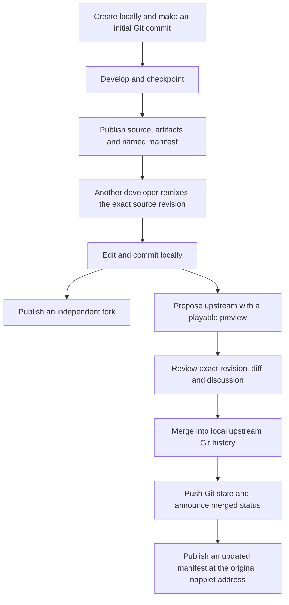

# napplet.soy protocol specification

**Status: reconciled implementation and adopted metadata direction; rollout and remaining questions open.**

This document records the events, standard reuse, Soy extensions and collaboration
flows used by napplet.soy and soyLI, plus the adopted metadata direction and open
interoperability questions. It is the protocol reference for
[issue #13](https://github.com/zeSchlausKwab/napplet-soy/issues/13).

This branch is based on main
[`f6bbcbfc92899716bc3dcb1065889472dc055596`](https://github.com/zeSchlausKwab/napplet-soy/tree/f6bbcbfc92899716bc3dcb1065889472dc055596),
reconciled on 2026-10-13. It implements D1: fresh publications carry optional
presentation references on the napplet manifest without a companion event.
Unless marked historical, implementation statements describe this branch, not a
production deployment. The previous kind-32267 writer remains only for frozen
publication retries, and existing signed descriptors remain readable. No signed
history is rewritten or migrated automatically. The bounded downstream contract
in §4.3 is implemented; broader policy, interoperability and rollout questions
remain open in D2, D3, D5 and D6.

## Contents

1. [Principles and identities](#1-principles-and-identities)
2. [Standards and compatibility baseline](#2-standards-and-compatibility-baseline)
3. [Event inventory](#3-event-inventory)
4. [Napplet publication and presentation](#4-napplet-publication-and-presentation)
5. [Source and collaboration](#5-source-and-collaboration)
6. [Social interactions and lifecycle](#6-social-interactions-and-lifecycle)
7. [Application data and backends](#7-application-data-and-backends)
8. [Decisions and open questions](#8-decisions-and-open-questions)
9. [Verification and implementation map](#9-verification-and-implementation-map)

## 1. Principles and identities

A napplet is an ordinary public napplet regardless of its publisher. Soy-specific
metadata, a particular Git host, a hashtag, a site account, or use of soyLI must
not become requirements for discovery or playback. Capabilities, verified bytes
and host policy determine whether it can run. Optional metadata can fail without
making the executable manifest invalid.

| Entity | Identity | What an update means |
| --- | --- | --- |
| Creator/player | Nostr public key | Profile names and pictures can change without changing the key. |
| Named napplet | `35129:<author-hex>:<d>` | A newer manifest replaces the current manifest at the same address. |
| Root napplet | `15129:<author-hex>:` | A newer replaceable event updates that author's root napplet. |
| Independent snapshot | Kind-5129 event ID | A new snapshot is a different event, not a replacement at a napplet address. |
| Napplet release | Exact signed manifest event ID | Identifies one publication, including its metadata claims. |
| Executable artifact | SHA-256 of the raw HTML bytes | Identifies bytes; it does not identify an author or prove source correspondence. |
| Verified runtime instance | NIP-5D `(dTag, artifactHash)` mapped to an iframe Window | Binds messages to the exact code being run; distinct from the stable publication address. |
| Source repository | `30617:<maintainer-hex>:<repository-d>` | Repository metadata and signed refs can change independently of a napplet release. |
| Source revision | Repository plus Git commit ID | Selects a source tree and history. The current Git adapter uses 40-character object IDs. |
| Proposal | Root kind-1618 event ID, or external kind-1617 patch root | A kind-1619 event is a revision of a proposal, not a new napplet. |
| Application-data record | Kind-30078 author plus `d` | A newer signed event replaces that author's record. |

An `naddr` carries an address and optional relay hints; changing hints does not
create a new identity. A friendly website route is a routing convenience, not a
Nostr identity. Titles are not identifiers. The same HTML published by different
authors does not grant them access to each other's state or social history.

For named and root napplets, likes, comments and zaps are attached to the stable
address, with event IDs identifying the revision where relevant. Publishing a new
version must not create a new social thread. A standalone snapshot's ancestry
claims do not grant it the parent's identity, storage scope or deletion rights.
Legacy snapshots have a compatibility rule discussed below.

NIP-5D runtime identity and host persistence are separate. The host verifies the
signature and HTML hash before creating an opaque `allow-scripts` iframe and
checks `MessageEvent.source` on incoming calls. Soy scopes host persistence using
verified author/napplet/artifact information; its public app-data convention
derives a stable author/napplet scope across updates. Those are documented host
policies, not a claim that NIP-5D defines one universal storage or social key.
Capability declarations advertise needs; they do not grant signing or network
authority. Signing remains mediated by the shell.

## 2. Standards and compatibility baseline

The following pins identify the contracts this implementation was built against.
They are not claims of conformance to every later upstream revision.

| Contract | Selected reference | Use and boundary |
| --- | --- | --- |
| NIP-01 and NIP-19 | [Event semantics](https://github.com/nostr-protocol/nips/blob/master/01.md), [identifiers](https://github.com/nostr-protocol/nips/blob/master/19.md) | Signatures, event IDs, replacement and portable identifiers. |
| Standalone NIP-5D | [Revision `4d0fb2e`](https://github.com/dskvr/nips/blob/4d0fb2e9fa1fdca71be09b17a4c5f382fbca5d51/5D.md) | Authoritative napplet manifest shape; selected PR #7 has merged upstream. |
| Legacy NIP-5D | [Revision `24711d9`](https://github.com/dskvr/nips/blob/24711d9c47bbdd07908bf1d52bf677d9cbc530f0/5D.md) | Read compatibility for path/aggregate manifests; not the default for new jobs. |
| NIP-34 | [Revision `6d2979b`](https://github.com/nostr-protocol/nips/blob/6d2979b3f503a8539c983efbcdcf901bbcf9ed23/34.md) | Git repositories, signed refs, proposals, updates and statuses. |
| GRASP | [Protocol](https://ngit.dev/protocol/grasp), [local pin record](services/grasp/upstream.json) | Standard Git hosting and NIP-34 integration; implementation 3.0.2 at `cdda4a2`, specification pin `f35b4f9`. |
| NIP-22 | [Revision `13664fb`](https://github.com/nostr-protocol/nips/blob/13664fb18a3ce5fa48a849de012ab789d82eb254/22.md) | Comments on napplets and proposals, with root and immediate-parent references. |
| NIP-25 / NIP-57 | [Reactions](https://github.com/nostr-protocol/nips/blob/master/25.md), [zaps](https://github.com/nostr-protocol/nips/blob/master/57.md) | Social signals and payment receipts; the invoice compatibility deviation is explicit in §6. |
| NIP-78 / NIP-32 | [Application data at `6aeea60`](https://github.com/nostr-protocol/nips/blob/6aeea6093786644e892dd2869fa5b642fddd271d/78.md), [labels](https://github.com/nostr-protocol/nips/blob/master/32.md) | Existing kind-30078 plus a Soy record convention and public-access policy. |
| Blossom | [BUD specifications](https://github.com/hzrd149/blossom/tree/master/buds) | Content-addressed artifacts, media and archives; signed HTTP authorization, not a replacement for Git. |
| NAP-CVM / NAP-WEBRTC | [PR #31 at `ad68a93`](https://github.com/napplet/naps/pull/31), [PR #59 at `5fae95d`](https://github.com/napplet/naps/pull/59) | Browser-to-shell APIs. ContextVM SDK 0.13.16 and `soy-rtc/1` provide separate wire implementations. |

[NIP-5A](https://github.com/nostr-protocol/nips/blob/master/5A.md),
[NIP-89](https://github.com/nostr-protocol/nips/blob/master/89.md),
[NIP-92](https://github.com/nostr-protocol/nips/blob/master/92.md) and
[Zapstore's event conventions](https://github.com/zapstore/zsp#nostr-events)
explain the legacy companion format. They do not collectively standardize the
entire Soy presentation contract. In particular, the standalone NIP-5D manifest
is no longer derived from NIP-5A.

The host continues to read legacy manifests. New soyLI jobs use standalone
manifests; frozen pending jobs keep their original signed bytes and format.
Optional source or presentation data is not needed to interpret either format.
See [migration semantics](docs/NIP5D-MIGRATION.md) and the more detailed
[protocol compatibility contract](docs/PROTOCOL.md).

## 3. Event inventory

This inventory covers first-party publication, interpretation and transport. A
permitted generic relay operation can handle other event kinds; that does not
make each of those kinds part of Soy's own application protocol.

### Public application and collaboration events

| Kind | Writer / reader in Soy | Standard or convention |
| --- | --- | --- |
| `35129` | Creator publishes named napplet; shell and soyLI read. | Selected standalone NIP-5D, with the optional extensions listed in §4. |
| `15129` | Shell reads root napplet. The normal soyLI publisher writes `35129`. | NIP-5D. |
| `5129` | Creator optionally publishes a snapshot; proposal previews embed a signed snapshot without publishing it to the gallery. | NIP-5D; legacy interpretation retained. |
| `32267` | Legacy presentation reader; writer only when resuming an older frozen publication. Fresh jobs do not emit it. | Zapstore software-application convention with Soy linking/selection conventions. Not a software-release event. |
| `31990` | Presentation reader can resolve an explicitly linked handler descriptor. | NIP-89 kind; using it for napplet presentation is an adapter convention. soyLI does not emit it here. |
| `30617` / `30618` | Repository owner publishes announcement / signed repository state; clients read both. | NIP-34 and GRASP. |
| `1618` / `1619` | Contributor publishes proposal / revision; shell and soyLI read. | NIP-34 plus optional `soy-preview`. |
| `1617` | Reader accepts external patch roots. Applying/revising patch series is delegated to Git/ngit. | NIP-34; not the format generated by `soyli propose`. |
| `1630` / `1631` / `1632` / `1633` | Reader interprets open / merged / closed / draft statuses. soyLI writes the first three. | NIP-34, subject to proposal-author/maintainer authorization. |
| `1111` | Signed-in user or CLI signer posts comments and replies. | NIP-22, for napplets and proposal discussions. |
| `7` | User signs likes/reactions; shell aggregates. | NIP-25. |
| `9735` | Lightning service publishes zap receipt; shell verifies and aggregates. | NIP-57. The shell does not fabricate receipts. |
| `1` | User explicitly shares an editable promotional note. | Ordinary Nostr note; optional topic tags/media are not discovery requirements. |
| `30078` | Player saves public structured records through constrained host operations. | NIP-78 kind, NIP-32 labels, Soy `soy.app-data/1` payload and access policy. |
| `0` | Profile resolver reads; explicit profile editing writes. | NIP-01/24 metadata. |
| `3`, `10002`, `10063` | Follow, relay and Blossom-server discovery; supported list operations can update these. | NIP-02, NIP-65 and Blossom BUD-03 respectively. |
| `10000`, `10001`, `10003`, `10006`, `10007`, `10015`, `30000`, `30002`, `30003`, `30015` | Supported LIST operations read/update user lists and sets. | [NIP-51](https://github.com/nostr-protocol/nips/blob/master/51.md) families; no Soy kind allocation. |
| `5` / `1984` | Author requests deletion / viewer files a report. | [NIP-09](https://github.com/nostr-protocol/nips/blob/master/09.md) / [NIP-56](https://github.com/nostr-protocol/nips/blob/master/56.md). Local moderation decisions are separate. |

**Not emitted by this publishing flow:** Zapstore kind `30063` software releases
and kind `3063` software assets. Calling a legacy `32267` companion a
“Zapstore release” obscures that distinction.

### Authorization and transport events

These must not be confused with public napplet releases or feed content.

| Kind | Where it goes | Meaning |
| --- | --- | --- |
| `9734` | Signed zap request sent to the recipient's LNURL callback. | NIP-57 request; not normally broadcast as a public note. |
| `24133` | Remote-signer relays. | [NIP-46](https://github.com/nostr-protocol/nips/blob/master/46.md) encrypted signer messages. |
| `24242` | Blossom HTTP authorization. | BUD-02 authorization; not a public listing event. |
| `27235` | Authenticated HTTP requests. | [NIP-98](https://github.com/nostr-protocol/nips/blob/master/98.md), including site administrative operations. |
| `25050` | Ephemeral signaling over relays. | **Soy-selected kind**, `soy-rtc/1`; not a NIP-100 conformance claim. |
| `25910` | ContextVM message transport. | SDK's inner MCP-message kind; outer encryption/wrapping is separate. |
| `1059` / `21059` | ContextVM encrypted transport, according to SDK negotiation. | Gift-wrap transport using NIP-44 encryption; `21059` is the SDK's ephemeral variant. These are not Soy allocations. |
| `11316` / `11317` | ContextVM service discovery when announcements are enabled. | SDK server / tool-list metadata. These numeric kinds are replaceable, not addressable. |
| `1` with `t=soy-board-registration-v1` or `t=soy-backend-authorization-v1` | Passed inside MCP requests, not posted to a social feed. | **Soy-specific use of an existing kind** for signed authorization payloads. |
| `1` with `t=soy-backend-build-v1` | Returned as a signed backend build receipt. | **Soy-specific use of an existing kind**, not a NIP-57 payment receipt. |

The ContextVM SDK also defines discovery kinds `11318`–`11320` for resources,
templates and prompts; their existence in the dependency is not a claim that
this tools-based service publishes those capabilities. Encryption and transport
kinds do not define the application schemas carried inside them.

## 4. Napplet publication and presentation

### 4.1 Executable manifest

The manifest signs the executable hash, capability declarations and descriptive
claims. Its signature identifies who published those claims. `x` is the SHA-256
of the **raw, single HTML artifact**, not a source-archive hash or legacy
aggregate hash. The shell verifies downloaded bytes before running them.

This abbreviated template illustrates the current named publisher. Angle-bracket
values are placeholders; cryptographic event fields are omitted. Examples in this
document are explanatory templates, not signed fixtures to import.

```json
{
  "kind": 35129,
  "content": "Build a little island together.",
  "tags": [
    ["d", "little-island"],
    ["x", "<html-sha256>"],
    ["title", "Little Island"],
    ["server", "https://blossom.example"],
    ["R", "cvm"],
    ["O", "webrtc"],
    ["icon", "<icon-sha256>", "image/png"],
    ["t", "multiplayer"],
    ["source", "nostr://<author-npub>/wss%3A%2F%2Fgit.example%2F/little-island"],
    ["source-commit", "<git-commit>"],
    ["source-archive", "https://blossom.example/<archive-sha256>"],
    ["presentation", "soy.presentation/1"],
    ["screenshot", "<cover-sha256>", "image/png"],
    ["preview", "<video-sha256>", "video/webm"]
  ]
}
```

| Field | Status at the selected NIP-5D pin | Soy behavior |
| --- | --- | --- |
| `d`, `x`, plaintext `content` | Core manifest fields, with kind-specific `d` rules. | Named publications use a stable `d`; exactly one raw artifact hash. |
| `title`, `server`, `source`, `R`, `O`, `icon`, `z`, `i` | Defined by standalone NIP-5D. | Supported; `z` declares archetypes and `i` declares intents. Icon is a hash plus MIME type. |
| Snapshot `a` / `A` | Parent / origin ancestry in standalone NIP-5D. | Emitted on optional snapshots where available, not used to impersonate a parent. |
| `t` | Reused Nostr hashtag pattern. | Optional topics for discovery. |
| `presentation`, `screenshot`, `preview` | **Optional Soy extensions**, not fields in the selected NIP-5D pin. | Direct hash/MIME media claims under `soy.presentation/1`; contract below. |
| `app` | **Legacy Soy extension on the standalone manifest**, inherited from NIP-5A-derived presentation. | Retained descriptor reader and frozen-job writer; omitted by fresh jobs. |
| `source-commit` | **Soy extension.** | Exact Git revision; ordinary source URLs alone do not pin a revision. |
| `source-archive` | **Soy extension.** | Hash-addressed archive fallback for the selected committed source tree. |
| `soy-source-repository` | **Soy extension.** | `["soy-source-repository", "30617:<owner>:<repo>", "linked"]` protects a linked repository from managed cleanup. |
| `remix-version` | **Soy extension.** | Pins the parent manifest event ID for genealogy; not a transfer of ownership. |

The writer publishes a named manifest by default. `publish --snapshot` also
publishes an independent snapshot. Old path/aggregate manifests use `path`,
aggregate `x`, `requires` and older metadata conventions; readers keep that
interpretation without rewriting the signed event. A legacy same-author snapshot
may carry its original named-address association; that compatibility rule does
not apply to new standalone snapshot ancestry.

### 4.2 Legacy companion compatibility

Older soyLI jobs sign a kind-32267 event when a cover exists, with the same creator
and release timestamp. Its `d` contains the napplet identifier and a release-job
suffix. The manifest links that address with `app`. Resuming an older frozen job
retains this format, including a companion published before its saved manifests.
Fresh jobs use §4.3 instead; this change does not delete old events or media.

```json
{
  "kind": 32267,
  "content": "Build a little island together.\n\nhttps://blossom.example/<video-sha256>",
  "tags": [
    ["d", "little-island-<release-suffix>"],
    ["name", "Little Island"],
    ["image", "https://blossom.example/<cover-sha256>"],
    ["imeta", "url https://blossom.example/<video-sha256>", "m video/webm", "x <video-sha256>", "size 123456", "dim 1200x750", "alt Little Island preview", "thumb https://blossom.example/<cover-sha256>"],
    ["license", "MIT"],
    ["repository", "https://git.example/<author-npub>/little-island.git"],
    ["latest", "35129:<author-hex>:little-island", "wss://relay.example"],
    ["t", "multiplayer"]
  ]
}
```

`image` holds the cover URL. The optional video URL occurs in `content`, with
NIP-92-style `imeta` for its hash, type, dimensions and thumbnail. `repository`
is a clone hint. `latest` points back to the named napplet; this napplet-target
interpretation is a Soy convention, not a general Zapstore release relationship.
If no video is present, neither its content URL nor its `imeta` is emitted.

The presentation reader resolves explicit `app` addresses of kind `32267` or
`31990`, checks signatures, and selects the current event at that address.
The legacy generated companion has the manifest author's key; the general reader also
supports explicitly linked descriptors from another author. That is attribution
through a signed link, not a transfer of napplet ownership. A descriptor's
`repository` does not override the manifest's release-source binding.

**A release-specific `d` is not immutable.** Kind 32267 is still addressable and
can be replaced. The legacy `app` link pins an address, not an exact descriptor
event ID or descriptor hash. A later event at that address can change the media
shown for an old manifest. This is a decision to make explicit, not hide behind
the word “release.”

The reader also supports the standard manifest `icon` and fallback presentation.
A missing companion, failed image or missing source never becomes a runtime
requirement. The current normal publisher provides one cover and an optional
preview clip, not a standardized ordered screenshot gallery with mobile/desktop
roles. The clip profile is currently silent VP8 WebM, at most 12 seconds and
5 MiB; these are Soy presentation limits, not NIP-5D requirements.

### 4.3 Direct manifest presentation — implemented downstream contract

[napplet/web PR #111](https://github.com/napplet/web/pull/111), reviewed at
`6dd79febfa9807d5d3f51cabd77b793f5893d4b7`, adds CLI
screenshot capture and deployment of `/screenshots/*.png` through a path-based
manifest. It does **not** define a standalone NIP-5D screenshot or video tag.
It should not be cited as if it had settled this wire contract.

Fresh soyLI jobs use this optional versioned Soy convention:

```json
[
  ["presentation", "soy.presentation/1"],
  ["screenshot", "<image-sha256>", "image/png"],
  ["preview", "<video-sha256>", "video/webm"]
]
```

These are **implemented Soy extensions**, not adopted NIP-5D fields. The parser
accepts the profile on signed named, root and independent snapshot manifests from
any publisher. Exactly one two-element `presentation` marker must name
`soy.presentation/1`. Up to four `screenshot` tags and one `preview` tag are
accepted; each has exactly three elements: tag name, lowercase SHA-256 and MIME.
Screenshots support PNG/JPEG/WebP and the clip supports the bounded silent VP8 WebM
profile in §4.2. The writer supplies one PNG and an optional clip, on the current
manifest and the snapshot only when `--snapshot` was requested.

Readers try screenshots in signed order, then legacy descriptor images, the
standard icon and generated art. Direct clips precede legacy clips. Identical
image claims are deduplicated; conflicting MIME claims for the same hash are
ignored. Unsupported/malformed entries are ignored; excess entries suppress that
media type, and missing/ambiguous/unknown profile markers suppress the profile.
None of these optional failures invalidates the playable manifest.

Media bytes are separate Blossom objects, discovered at `/<hash>` on declared
origin-only `server` hints. Readers verify hash, MIME and actual raster/container
format before rendering, with bounded downloads, redirect refusal and public
network policy. Indexed covers are normalized cached PNGs; browser-only previews
use verified Blob URLs. Unavailable media falls back without changing playback.
Sharing, asset links, OG covers and deletion inventory use the same signed claims;
shared blobs remain protected by the existing lifecycle checks. Detailed budgets
and cache behavior are in [PREVIEWS.md](docs/PREVIEWS.md).

D1 settles placement, not a universal gallery schema. This initial contract has
no mobile/desktop role, caption, alt-text or rich taxonomy schema. NIP-92 `imeta`
remains a possible upstream convention, not another format emitted by this writer.
Those extensions, longer-term historical presentation policy, source attestations
and rollout remain open in D2, D3, D5 and D6. No new companion kind is allocated.

### 4.4 Publishing sequence and partial failure

A new publication binds the creator, existing napplet identity, Git commit,
built HTML, archive and media in a resumable local job. Managed source prepares
NIP-34 announcement/state events, pushes Git objects through GRASP and checks
read-back; linked source instead verifies existing signed refs and reachability.
Artifacts and media go to Blossom. Fresh jobs publish the optional snapshot and
current manifest with direct media references, then check indexing. No separate
presentation event or acknowledgement is needed. Older frozen jobs retain their
original descriptor, snapshot choice, destinations and signatures.

A fresh publication after a completed legacy job adopts the direct profile even
when HTML is unchanged. It retains the creator and stable napplet address; this
requires an explicit publish, not merely installing a CLI update. Executable `x`
and source bindings continue to identify the frozen bytes and commit. Existing
remote-conflict checks prevent a stale job from overwriting a newer publication.

This is not an atomic transaction spanning Git, Blossom and relays. Retrying a
frozen job reuses its identities and signed events; it must not mint another
napplet just because one destination was slow. Publication and metadata migration
must preserve this property. Source availability is important to soyLI's publishing
promise, but another publisher's otherwise valid manifest can be played without it.

## 5. Source and collaboration

### 5.1 Git and GRASP already provide the underlying model

Collaboration uses Git, NIP-34 and GRASP directly, without a separate Soy protocol
wrapper. “Remix,” “checkpoint,” “propose” and the visual tree are UI/CLI conveniences
over those objects. The optional `soy-preview` attachment adds playable reviews
to standard proposals (§5.3). Source discovery, remixing, playable proposals,
review and merge do not depend on a metadata companion.

Managed repositories use ordinary Git and standard NIP-34 events:

- Kind `30617`: `d`, `name`, `clone`, `relays`, `r <root-commit> euc`, and an
  optional `u` upstream-repository relationship.
- Kind `30618`: repository `d`, `refs/heads/main`, `HEAD` and retained
  `refs/tags/release-<suffix>` values selecting actual Git commits.
- GRASP hosts Git objects and interprets signed repository state. A relay
  acknowledgement while waiting for Git objects is not sufficient publication
  evidence; soyLI also checks refs and relay read-back.

A linked existing repository is different from a repository managed by soyLI.
The linked-source flow verifies signed state and commit reachability but does
not push to that repository. The separate collaboration `push` command publishes
the checked-out existing upstream branch while preserving other signed refs and
HEAD. It supports the owner and directly listed maintainers with reciprocal
repository announcements; recursive/role-based authority and branch creation or
deletion remain Git/ngit workflows. These are adapter limits, not reasons for a
replacement repository protocol.

The standard manifest `source` is the discovery entry point. `source-commit`
pins the revision and `source-archive` offers checked archive bytes. A signed
hash proves attribution and byte integrity; it does not by itself prove that a
binary/HTML artifact was built from the advertised source. Build reproducibility
and independent verification are separate questions.

### 5.2 User flow and its wire effects



Forking and proposing are independent choices. A contributor can publish their
own remix before or after proposing, or propose without creating a gallery entry.
The original creator's decision to merge does not delete the contributor's fork.

| Action | Implemented effect | Not implied by that action |
| --- | --- | --- |
| `soyli new` | Initial local scaffold commit. | No identity required and nothing uploaded. |
| `soyli checkpoint` | Ordinary local Git commit after source checks. | No remote announcement. |
| `soyli publish` | Source/artifact publication and a manifest under the selected creator's stable napplet identity. | No upstream merge. |
| `soyli remix` | Resolves the exact source commit, preserves Git ancestry, creates `pr/my-changes`, sets upstream remotes and an ignored local publication binding. | No rewrite of upstream; no automatic publication. |
| `soyli propose` | Kind-1618 root or kind-1619 update, upstream `refs/nostr/<event-id>` source hosting and optional playable attachment. | No contributor repository announcement or named napplet release. |
| `soyli review` | Pinned revision, Git diff, comments and supplied runnable preview. | No automatic dependency installation or contributor build execution. |
| `soyli merge` | Explicit revision and target-HEAD checks, then local Git merge. | No push, release or proposal deletion. |
| `soyli push` | Publishes managed Git state and kind-1631 status for included proposals. | No new playable napplet release until `publish`. |

Git-backed remixes retain history. Archive/HTML remixes can still be useful but
cannot invent an upstream Git ancestry for a proposal. If a promised Git source
is temporarily unavailable, the CLI must not silently downgrade to an unrelated
history. Local `.napplet-space` bindings and journals are tooling state, not a new
public protocol object and not credentials to distribute with the source.

### 5.3 Proposal and revision contract

A contributor signs a kind-1618 root with NIP-34 repository `a`, earliest unique
commit `r` where known, maintainer `p` tags, `subject`, `branch-name`, tip commit
`c`, `clone` URL and `merge-base`. Revisions use kind `1619`, retain the target and
commit/clone information, and reference the root with `E` and its author with `P`.

The adapter advertises eligible upstream clone URLs and delivers the signed
proposal followed by the standard GRASP `refs/nostr/<event-id>` ref. It verifies
that ref, commit retrieval and relay read-back before reporting success. It does
not create a contributor repository or request kind-30617/30618 signing for a
proposal, and does not silently fall back to doing so. Legacy signed journals
retain their original clone references. Optional GRASP-06 is not used. A later
revision can use upstream hosting without rewriting earlier signed revisions.

The additional Soy attachment is one tag on the signed proposal/revision:

```json
["soy-preview", "https://blossom.example/<descriptor-sha256>", "<descriptor-sha256>", "<git-commit>"]
```

Its hash-checked JSON descriptor has this shape:

```json
{
  "version": 1,
  "commit": "<same-git-commit-as-proposal-c>",
  "manifest": {
    "kind": 5129,
    "content": "Build a little island together.",
    "tags": [
      ["x", "<html-sha256>"],
      ["server", "https://blossom.example"],
      ["source-commit", "<same-git-commit-as-proposal-c>"]
    ],
    "created_at": 1791763200,
    "pubkey": "<proposal-author-hex>",
    "id": "<snapshot-event-id>",
    "sig": "<snapshot-signature>"
  },
  "check": {"profile": "<checked-host-profile>", "browser": "<checked-browser>"},
  "image": "https://blossom.example/<cover-sha256>"
}
```

The real nested manifest includes the project's title, capabilities and other
applicable metadata; its signature is verified. `image` is optional. Current
preview snapshots can also carry an `image` URL tag as a Soy extension. The JSON
is bounded to 64 KiB and bound to the contributor, proposal revision and commit.
The embedded snapshot is not itself announced as a gallery listing.

Every update needs its own matching attachment. A previous revision's preview
must never substitute for the selected revision's preview. `check` is the
contributor's report, not an independent host attestation. Opening a proposal
runs the supplied checked artifact in the napplet sandbox. Rebuilding contributor
source is a separate explicit action, not something a metadata fetch should do.

A standard NIP-34 client can ignore `soy-preview` and still fetch, discuss and
merge the proposal. Conversely, an external NIP-34 proposal without this tag
remains visible in Soy, but may not have a playable preview. This is the principal
existing protocol extension behind the simplified collaboration experience.

### 5.4 Merge and subsequent publication

A review pins both the proposal revision and local target HEAD. Conflicts,
identity changes or a changed target require a refreshed decision. NIP-34 status
events are signed claims from an authorized proposal author/maintainer; a “merged”
status alone is not cryptographic proof of integration into a particular branch.
The local/push path checks Git ancestry before announcing its merged status.

Proposal comments use NIP-22, with the proposal as the root and a comment as the
immediate parent for replies. Merging preserves the root proposal, revisions,
Git authorship and discussion. The maintainer separately publishes the new game
version at the original napplet address, preserving its social identity.

## 6. Social interactions and lifecycle

### Stable targets and NIP-22

For a named napplet, a kind-7 reaction includes the manifest `e`, creator `p`,
manifest `k` and stable napplet `a`. A top-level kind-1111 comment uses this shape:

```json
[
  ["A", "35129:<creator>:little-island"],
  ["K", "35129"],
  ["P", "<creator>"],
  ["a", "35129:<creator>:little-island"],
  ["k", "35129"],
  ["p", "<creator>"],
  ["e", "<manifest-revision-id>"]
]
```

A reply retains uppercase root tags and uses lowercase `e`, `k=1111` and `p`
for the immediate parent. Independent snapshots use event-root `E`/`e` instead
of a named address. Proposal discussions use the same NIP-22 root/parent model.
Reactions and zaps to a comment target the comment's event and author, not the
napplet creator. The reader tolerates missing root `P` in otherwise compatible
older comments; the writer emits it.

### Zap requests, receipts and payment feedback

The shell requests an invoice with a signed kind-9734 zap request, referencing
the recipient and appropriate address/event. The Lightning provider, not the
shell or payer, signs kind 9735 after settlement. The reader checks attribution,
request/target binding, invoice and amount before counting a receipt. Addressable
napplet updates retain their zap scope even if an old manifest is no longer
available from a relay.

There is an intentional compatibility exception: the invoice path can accept a
plain BOLT11 description from providers that do not implement the NIP-57
request-hash requirement. When a description hash is present, a mismatch is
still rejected. This is **not strict NIP-57 invoice compliance**. Verified local
payment evidence and provider status checks can drive payment feedback, but do
not manufacture a globally verifiable kind-9735 receipt. A paid QR invoice and a
published zap receipt are distinct facts; external-wallet payments need provider
confirmation or a discoverable receipt for the shell to learn the outcome.
See [zap implementation and confirmation behavior](docs/COMMUNITY.md).

### Unpublish, delete and moderate

Authors request removal of their own events with NIP-09. Unpublishing preserves
source/assets for later republishing; a later publication can reuse the napplet
address with a new event. Deleting hosted assets, hosted repository data and
backend state are separate operations with separate retention and authority
rules. A deletion request cannot guarantee removal of relay copies, cached media,
other people's forks or their comments.

Blossom storage uses signed authorization and host ownership/retention policy;
Git cleanup follows the GRASP host's retention policy. Linking an existing
repository does not authorize deleting that repository with the napplet.
Friendly routes, featured placement and moderator decisions are currently site
state administered through authenticated HTTP, not a newly allocated public
curation event kind. NIP-56 reports are public input to moderation, not the
moderator's decision itself. See [lifecycle](docs/LIFECYCLE.md) and
[moderation](docs/MODERATION.md).

## 7. Application data and backends

These are separate from app presentation and Git collaboration. They belong in
the inventory because they introduce additional schemas or reuse existing kinds
in ways a collaborator must understand.

### Public user-created data

`soy.app-data/1` is a convention over kind 30078, not a new NAP or kind. Its tags
are:

```json
[
  ["d", "soy.app-data/1:<scope-hash>:tracks:<record-id>"],
  ["s", "<scope-hash>"],
  ["c", "tracks"],
  ["L", "soy.app-data/1"],
  ["l", "example.track", "soy.app-data/1"],
  ["v", "1"]
]
```

`content` is JSON with `schema`, `version`, `title`, `previous` (event ID or
`null`), `deleted` (boolean) and application-defined `data`. The author plus `d`
identifies the record; the host derives scope from the verified napplet identity.
The current content limit is 16 KiB. Large payloads should use referenced assets.
Consumers still validate the application payload's schema.

This is intentionally public, with constrained relay access and viewer consent.
It differs from the selected NIP-78 revision's owner-only access recommendation.
`previous` detects observed conflicts; it is not a distributed compare-and-swap
or guarantee that every relay retains history. Tombstones describe application
state and do not erase third-party copies. See [shared data](docs/SHARED-DATA.md).

### Authoritative shared state through ContextVM

Scoreboards, rooms and deployable backend modules expose versioned MCP tools over
ContextVM. NAP-CVM is the browser API; the MCP schemas define service behavior.
For dynamic modules, developers register schemas and source/build inputs through
management operations. Players use describe/invoke operations to discover and
call permitted module methods. The provider binds the caller, validates input,
executes sandboxed logic and persists authoritative state.

Module IDs, entity revisions and database rows are **service objects**, not extra
napplet event kinds. The provider's signed build receipt connects source/materials,
artifact hash, schema/policy hashes and runtime profile. It is a provider's
attestation, not proof that every execution is honest or that a different host
reproduced the build. The signed kind-1 authorization envelopes and receipt in
§3 are application-specific reuse and deserve an explicit interoperability
decision if standardized. Exact service schemas remain in
[dynamic backend contracts](packages/dynamic-backends/src/contracts.ts) and
[backend documentation](docs/DYNAMIC-BACKENDS.md).

### Realtime state through WebRTC

`soy-rtc/1` currently uses ephemeral kind `25050` for rendezvous and signaling.
The `d` channel binding includes the verified napplet identity and channel scope;
messages expire, and targeted messages carry `p`. Hello messages announce a
session nonce; offer/answer payloads are encrypted with NIP-44 and tied to that
session. The actual game traffic travels on WebRTC data channels, not as one
relay event per movement.

STUN/TURN are ICE connectivity mechanisms; TURN relays peer traffic when a direct
path is unavailable. They are not an alternate authority for committing game
state. Peer movement can be fast and temporary while backend invocations enforce
persistent world rules. The current CVM client does not enable open streams or
oversized-transfer mode. Choosing a future transport does not itself settle
schema, authorization, ordering or conflict semantics. See
[ContextVM and realtime contracts](docs/CONTEXTVM.md).

## 8. Decisions and open questions

D1 is adopted as the metadata direction. D2, D3, D5 and D6 remain open within
that direction; they do not reopen the companion or GRASP-wrapper questions.
The branch implements the bounded presentation contract in §4.3. The remaining
questions below distinguish that behavior from future policy or upstream agreement;
no deployment or automatic rewriting of published events is implied.

### D1 — Metadata belongs on the napplet manifest

**Decided 2026-10-13: no metadata companion event.** Author-controlled discovery
and presentation metadata belongs on the napplet manifest. Do not introduce a
new Soy-specific companion kind or continue the Zapstore-style companion as the
future publishing model.

Rationale:

- The napplet event already identifies the application and references its HTML
  executable. A second listing would duplicate that role.
- The author's tags and taxonomy should be discoverable on the napplet itself,
  without another event lookup or competing source of truth.
- Named/root manifests already support replacement. A metadata-only revision can
  retain the artifact hash and source revision; a new signature does not imply
  a new executable. Independent kind-5129 snapshots remain immutable events.
- Author-controlled metadata shares the manifest's owner and lifecycle. We have
  no requirement for a separate listing publisher or delegated metadata owner.
- Another object adds linking, signing, replacement and synchronization complexity
  without a demonstrated benefit. Media bytes remain external; manifests carry
  bounded references whose field contracts still need agreement.

Independent labels, moderation, collections and reviews are separate claims about
a napplet, not another authoritative listing. Existing patterns such as NIP-32
can express third-party labels; this decision does not introduce a curation
schema or claim new reader support. Git/NIP-34/GRASP collaboration remains direct
and independent of the presentation format (§5).

The selected NIP-5D pin in §2 is unchanged. Fresh jobs implement direct metadata
under §4.3; §4.2 retains legacy readers and frozen-job retries. Existing signed
publications are not deleted or rewritten. D6 still needs rollout and migration
acceptance beyond these implemented compatibility paths.

### D2 — Current listing versus historical release presentation

If a creator replaces a screenshot tomorrow, should an old release page show the
old screenshot or the new one? Under D1, the latest manifest supplies the current
listing; an exact historical manifest can retain its original media references.
Decide which presentation each page selects and how historical events and assets
remain retrievable: replacement alone does not guarantee retention. The legacy
address-only `app` link can resolve newer media even for an old manifest, so
legacy presentation also needs an explicit policy.

The current bounded contract in §4.3 defines initial ordering and media checks.
Still open: richer galleries, explicit landscape and portrait roles, captions/alt text, additional video formats and their budgets,
and upstream interoperability for these fields. Hash-addressed bytes do not by
themselves identify a role. NIP-92 can supply media attributes, but the containing
object still needs selection rules.

Also decide whether metadata-only updates count as “recently updated.” They must
not reset first publication time, change napplet identity or detach social data.

### D3 — What is the canonical source link, and what does it promise?

Keep the standard manifest `source` as the minimum discovery entry point,
consistent with D1. Source availability remains optional for playback.

Open details: how should the manifest bind exact commits and archives? Should
the current Soy extensions remain or use a shared upstream convention?
How do we distinguish an immutable source snapshot from a moving default branch?
Who may attach build attestations, and what verifies source-to-artifact
correspondence? A useful source link, a reachable Git commit, a checked archive,
and a reproducible build are progressively different claims.

### D5 — Which extensions need upstream coordination?

The extension surface includes more than media: `source-commit`, `source-archive`,
`remix-version`, `soy-source-repository`, `soy-preview`, `soy.app-data/1`,
`soy-rtc/1` kind 25050, and non-feed kind-1 authorization/build envelopes.

For each, decide whether to retain a versioned Soy convention, propose a NIP/NAP
extension, or reuse a more suitable existing form. Separate ContextVM SDK kind
choices from Soy allocations. D1 removes the companion kind/schema allocation
question; it does not standardize manifest media fields or any other extension.
A future CEP for backend schemas remains a separate decision.

### D6 — Compatibility and rollout

Implemented now: direct/legacy readers, fresh direct publishing, preserved frozen
retries and stable publication identity. Reader deployment must precede the CLI
release. No deployment is included in this PR. Remaining rollout acceptance:

- Can both standalone and legacy manifests still be listed and played without
  optional source/media being reachable?
- Which new reader ships first, and which older clients still show useful data?
- Does migration update the existing address, preserving social history and
  first publication time, instead of minting a duplicate napplet?
- Are old companion references still resolvable for old signed manifests?
- Do pending publication journals resume their frozen format without re-signing
  different bytes under the guise of a retry?
- Is rewriting a publication an explicit author action? Can migration explain
  exactly which claims will change before asking the signer?
- Are deprecated companion events and media retained where old releases or other
  publications still reference them?

### Decision record

| ID | Status | Rationale or remaining evidence |
| --- | --- | --- |
| D1 | Decided 2026-10-13: author-controlled metadata on the manifest; no companion event | One owner and identity, direct discovery, existing replacement semantics and fewer dependencies. Initial downstream contract implemented in §4.3; broader policy and rollout remain open below. Not deployed by this PR. |
| D2 | Open | Current-versus-historical presentation policy, retention and media selection rules. |
| D3 | Open | Canonical source field and exact-revision/attestation contract. |
| D5 | Open | Extension inventory reviewed with relevant upstream maintainers. |
| D6 | Open | Compatibility matrix, explicit migration behavior and retry fixtures. |

Record an adopted decision with its rationale, protocol revision, compatibility
impact and tests. Updating this table is not itself deployment evidence.

## 9. Verification and implementation map

The implementation includes signed direct and legacy fixtures plus publisher,
cache, browser and lifecycle regressions. Independent-client rendering and
production rollout remain separate acceptance work. Verification must cover: new
and legacy playback without companions; metadata lookup failure; changed/replaced legacy companions; metadata-only manifest updates that
preserve artifact/source bindings and cannot restore a stale executable;
source/preview hash and author mismatches; standard proposals with no preview;
proposal updates with a stale attachment;
merge without publication; stable social targets after publication/migration;
and retry of a partially completed frozen job.

Repository limits are implementation budgets, not Nostr protocol quotas. Here, soyLI publishes HTML up to 25 MiB; website/indexer/runtime reading allows
100 MiB. Source checks permit 1,024 files and 40 MiB of reachable/expanded source,
with additional archive and object-count bounds. Optional metadata formats must
not accidentally turn those publishing limits into universal playback rules.

| Area | Implementation / detailed contract |
| --- | --- |
| Manifest validation and identity | [protocol package](packages/protocol/src/manifest.ts), [protocol contract](docs/PROTOCOL.md), [NAP audit](docs/NAP-REVIEW.md) |
| Publisher and legacy retry writer | [publisher](packages/publish/src/index.ts), [publishing](docs/PUBLISHING.md) |
| Presentation resolution | [descriptor reader](packages/protocol/src/preview.ts), [video reader](packages/protocol/src/preview-video.ts), [preview contract](docs/PREVIEWS.md) |
| Git and GRASP | [source client](packages/grasp/src/client.ts), [GRASP integration](docs/GRASP.md) |
| Remixes and collaboration | [collaboration service](packages/collaboration/src/service.ts), [proposal parser](packages/collaboration/src/protocol.ts), [collaboration guide](docs/COLLABORATION.md), [remixing](docs/REMIXING.md) |
| Social targets | [social event templates/validation](packages/protocol/src/social.ts), [social features](docs/COMMUNITY.md) |
| Public structured records | [app-data contract](packages/app-data/src/app-data-contract.ts), [shared data](docs/SHARED-DATA.md) |
| Dynamic backend schemas | [contracts](packages/dynamic-backends/src/contracts.ts), [service](packages/dynamic-backends/src/service.ts), [backend guide](docs/DYNAMIC-BACKENDS.md) |
| Runtime and transport boundaries | [playback identity](packages/runtime/src/playback.ts), [runtime actions](docs/RUNTIME-ACTIONS.md), [ContextVM/WebRTC](docs/CONTEXTVM.md), [compatibility](docs/COMPATIBILITY.md) |
| Lifecycle | [lifecycle](docs/LIFECYCLE.md), [identity](docs/IDENTITY.md), [moderation](docs/MODERATION.md) |

The [Plebeian Market](https://github.com/PlebeianApp/market/blob/master/SPEC.md),
[Earthly](https://github.com/zeSchlausKwab/earthly/blob/master/SPEC.md) and
[Wavefunc](https://github.com/zeSchlausKwab/wavefunc/blob/main/SPEC.md) specifications
are examples of the concrete protocol documentation this file aims to provide;
their application schemas are not dependencies of napplet.soy.
