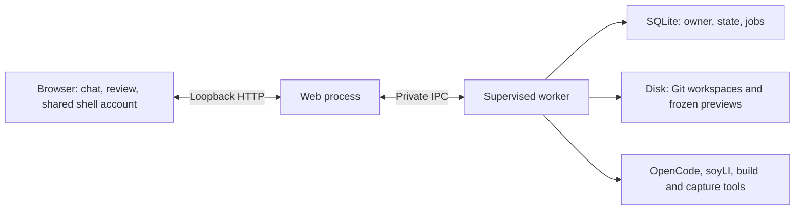

# Quick Vibe: local creation studio

A local beta, prompt-first workspace: describe a napplet,
play its checked build, keep iterating in the same conversation, and review a release for publication. Code and Git
changes are available alongside the preview. This is a local development tool,
this page documents the local mode. The hosted BYOK controller and its release
status are described in [STUDIO-HOSTING.md](STUDIO-HOSTING.md).

## Start

Prerequisites: this checkout's Bun dependencies, Git, and an inference provider or
local model server. Local Studio uses this checkout's soyLI for scaffolding,
setup, agent commands and verification, so its installed guidance matches the
Studio revision. An explicit `QUICK_VIBE_SOYLI` override selects a packaged CLI
for all four operations. Existing drafts and their guidance are preserved.
The current adapter is tested with **OpenCode V1
1.19.3** (`opencode-ai`, not the separate V2 package).

```sh
bun install --frozen-lockfile
npm install --prefix .local/quick-vibe/tools opencode-ai@1.19.3
bun run studio
```

Open the shared header’s **Account & settings → AI connections** to
save a named endpoint, model, API key and step limit. OpenRouter, OpenAI, Anthropic,
Google Gemini and DeepSeek have native provider adapters. Groq, Mistral, xAI,
Together, Fireworks, Ollama, LM Studio, llama.cpp and custom servers use an
OpenAI-compatible adapter. Select a model that supports tools and enough context
for the installed guidance; a model catalogue test does not certify those features.

Editing a saved connection fetches its model catalogue automatically. For a new
connection, enter the endpoint and key, then choose **Fetch models**. The dropdown
shows model names and exact IDs; larger lists also have a search field. **Enter a
model ID manually** supports aliases and servers without catalogue support. A
missing model or failed catalogue request never clears the existing selection.
Fetching an unsaved form does not save its key or other settings.

The model name beside the chat input opens the same picker for the active
connection. Choose a model and press **Use model** to save it for the next turn;
**Connections** opens the full settings dialog. Model changes preserve the endpoint,
key, step limit and draft. Controls wait for any active task to finish.

An existing `DEEPSEEK_KEY` in this checkout's ignored `.env` or shell is imported
**once**, when the connection store is first created. `QUICK_VIBE_MODEL` chooses
that imported connection's model. Later edits are managed in Connections; removing
it does not recreate it on restart. Startup works without a key.

Credentials are stored in `.local/studio/credentials/connections.json` with mode
`0600`, outside napplet Git workspaces. This is OS-user file protection, not encrypted
storage or a production credential vault. List/state responses return only
`hasKey`; the browser never receives a saved key. The selected key is written to
OpenCode's private auth file for the run and cleared on normal completion or the
next startup. Agent subprocess environments omit the checkout's other secrets.
Do not place credentials in a napplet or paste them into chat.

Connections can be edited, tested, selected and removed while the worker is idle.
Testing makes a bounded, non-redirecting model-catalogue request, without generation.
Discovery uses the same server-side request and keeps saved keys out of browser
responses. It supports OpenAI-compatible `/models` lists (including local servers),
Anthropic's header authentication and pagination, and Gemini's header authentication,
pagination and `models/` ID normalization. Gemini embedding-only models are omitted;
listing a model does not otherwise guarantee tool-calling compatibility. Each fetch
has a shared 10-second deadline, 8 MiB total response limit, 10-page limit and
2,000-model limit. A truncated list is identified as partial; manual IDs remain
available. Catalogues stay in the open picker rather than being stored in drafts.
Changing a credential's endpoint requires re-entering the key. Switching connection
or editing its configuration starts a fresh agent session with recent conversation
context, while retaining the repository, previews and full Studio chat history.
No provider fallback or automatic paid retry is performed.

Run the shell as well (`bun dev` for the normal development stack), then open
`http://127.0.0.1:3000/studio`. Studio is a page in the shell, with its shared header,
appearance control and account menu. AI connections and napplet handler defaults live
in that account/settings popover, including when signed out. The execution service still listens on loopback
port 4195; old Studio bookmarks redirect to the matching shell page. Ctrl+C in the
Studio terminal stops its worker/tools/previews, not the shell.

If the shell uses another port, set its exact origin when starting the worker, for
example `QUICK_VIBE_SHELL_ORIGIN=http://127.0.0.1:4196 bun run studio`.

The hostname must match too: `localhost` and `127.0.0.1` are different browser
origins. For `http://localhost:3000/studio`, start the service with:

```sh
QUICK_VIBE_SHELL_ORIGIN=http://localhost:3000 bun run studio
```

If Studio or AI connections shows **Failed to fetch / Reconnecting**, compare the
browser address with the shell URL printed when Studio starts. Stop that Studio
process and restart it with the matching origin and the same `QUICK_VIBE_HOME`;
drafts and saved connections stay in that store. A change to `VITE_QUICK_VIBE_PORT`
also requires restarting the shell. No wildcard origin permission is needed.

Optional configuration:

| Variable                  | Purpose                                                                                                                                                 |
| ------------------------- | ------------------------------------------------------------------------------------------------------------------------------------------------------- |
| `QUICK_VIBE_PORT`         | Loopback port; `0` chooses a free port.                                                                                                                 |
| `QUICK_VIBE_SHELL_ORIGIN` | Exact permitted local shell origin for API access and old-bookmark redirects; default `http://127.0.0.1:3000`. Only HTTP loopback origins are accepted. |
| `VITE_QUICK_VIBE_PORT`    | Set when starting/building the shell if Studio uses a port other than `4195`. Use an explicit Studio port for shell integration.                        |
| `QUICK_VIBE_HOME`         | Private state directory; default `.local/studio`.                                                                                                       |
| `QUICK_VIBE_OPENCODE`     | Absolute path to the pinned OpenCode executable.                                                                                                        |
| `QUICK_VIBE_SOYLI`        | Optional absolute path to a packaged soyLI; defaults to this checkout's source CLI.                                                                     |
| `QUICK_VIBE_MODEL`        | OpenCode model identifier; default `deepseek/deepseek-flash`. Used only for the initial DeepSeek import; saved settings take precedence.                |

## Navigation and saved creations

The shared shell header offers **Create in browser** and **Use soyLI locally**
as separate actions. **My work** opens `/manage`, combining private Studio drafts,
published napplets, incoming proposals, submitted contributions and recent activity. The shell's
`/create` page also explains both paths and retains its existing CLI setup guide.
Browser links stay on the same site. In a development build on HTTP loopback, Studio
connects to the configured local worker. Production builds use the configured
hosted Studio service; they never probe localhost or expose this trusted local runner.

Studio routes are `/studio` for the dashboard, `/studio/create` for a new draft,
and `/studio/<project-id>` for an existing workspace. Direct links, reload and
Back/Forward preserve the selected project. The dashboard offers search, ordering
by recent edits/creation/name, and filters for drafts, published releases, remixes
and work needing attention. Publication status reflects the saved Studio release
attempt; it does not discover projects published independently through the CLI.

**Remix this** offers browser creation alongside the existing soyLI commands.
The browser link preselects the exact release source and a suggested title.
Opening either creation link only opens a form: the user must submit a prompt to
create a repository or start inference. Explicit loopback remix sources use soyLI's
local network mode. Source resolution, attribution and publication still belong
to soyLI. Hosted public imports use the guarded Node transport described in
[Studio hosting](STUDIO-HOSTING.md); this setup happens before either build path.

A remix workspace immediately opens its original published napplet in the shared
verified player, independently of source import, inference and the selected build
mode. The footer labels this **Original napplet** until the first passing draft
preview is available. Import pins the preview to the exact selected manifest;
existing initialized drafts recover that pin from their local source binding.
Later edits keep the last passing draft visible. An unavailable original has its
own retry control and does not block editing. Previewing performs no project build
or AI call and creates no checkpoint or publication eligibility. New creations
without a published source retain the empty preview until checks pass.

Existing drafts remain in the same private store; this navigation change requires
no draft migration. The local controller still uses its token-protected loopback
HTTP adapter for connection settings and bounded binary asset uploads. Its CORS
allowlist is the single configured shell origin; other origins, including sandbox
`null` origins, are rejected. A read-only session handshake supplies the per-process
token. No automatic retries of writes occur after ambiguous network failures.

The embedded preview retains the real soyLI host bridge and sandboxed napplet frame,
but removes workshop chrome, padding and frame borders. Open preview still opens the
full workshop separately. The workspace fills the viewport below the header, with
scrolling retained for long chat/source content and no extra visible scroll tracks.
This does not choose a hosted REST API or change GRASP/Nostr publication protocols.
Rename/archive/export remain separate follow-up work. Remix proposals use the
reviewed submission flow described below.

## Shared visual theme

`packages/runtime/src/appearance.css` is the central theme for shell colors, light/dark
variants, font families and header width/gutters. The shell and Studio consume those
same variables; Studio has no separate palette or font stack. The shared palette uses
near-white/slate surfaces and deep teal actions, with soft coral,
mint and lilac accents. Darker text, clearer borders and solid selected controls
retain strong contrast. Shared `--tint-*` colors provide subtle card and toolbar
surfaces in both light and dark mode. Light mode uses forest charcoal for its
header, dark text and code panels, echoing the landing-page film's green backdrop;
dark mode retains its slate palette. Font files are loaded
once by `apps/web/src/styles.css` (add a matching font import there if choosing a new
web font). `apps/studio/style.css` holds workspace layout and component rules.

The header has the same alignment on browsing and Studio pages; only the editor
surface extends to the viewport edges. Intent-handler defaults are settings, not an
inline page footer. Theme changes do not style napplet documents inside their sandbox
or change the creative defaults shipped to developers.

## What the studio does

1. **Prepare.** Fresh drafts use `soyli new --identity later --no-install`, then
   `soyli setup`. The Remix option delegates source resolution and ancestry to
   `soyli remix`; it does not introduce a new collaboration protocol. Only use
   projects you trust to execute locally. Remixes retain soyLI's source selection
   and upstream binding; preparation does not register a public repository.
2. **Edit.** OpenCode works in the actual Git project. The controller supplies the
   installed soyLI and visual guides plus make/UI/test skill bodies, explicitly,
   on each turn. File discovery alone is not considered evidence of skill loading.
   The model can inspect and edit application files and run selected build checks.
   Project dependencies, build configuration, existing tests and installed guidance
   are protected; the controller checks them against the initial source revision.
3. **Verify.** By default, independently run `soyli run verify`, `soyli check`, and
   `soyli run test:conformance`. Capture failures and skipped cases from both output
   streams. A failure gets one agent repair pass, then another independent check.
   An agent's success claim or step-limit exit does not bypass these commands.
4. **Play.** Only passing builds replace the preview. Runtime inputs are copied to
   an immutable snapshot served by the existing soyLI host, including its real
   `allow-scripts` sandbox, hash verification and SDK bridge. Workshop presentation
   is compacted; snapshot mutation endpoints are disabled. The last passing build
   stays playable during edits, failures and cancellation. Passing checks do not
   certify gameplay, accessibility or responsive behavior: play the result and feed
   concrete observations back into chat. Skipped conformance checks remain skipped.
5. **Continue or restore.** Chat, OpenCode session IDs, diagnostics and checkpoints
   persist outside the project Git repository. Browser reloads reconnect to the
   current job. Controller restarts mark interrupted jobs stopped, without retrying
   inference automatically. History can restore a passing checkpoint after saving
   current source to a backup commit; it does not reset or rewrite Git history.

## Experimental browser builds

Enable **Browser builds** on the create/remix form or below an existing standard
TypeScript draft’s preview (on a phone, first open **Preview & code**). New drafts,
compatible remixes, **Build in browser** and subsequent chat turns then run
TypeScript 5.9.3 and esbuild WASM in a browser Web Worker. The initial create/remix
still uses soyLI to prepare the repository and install its pinned dependencies.
The worker receives a bounded source snapshot and the installed SDK files;
it does not execute package scripts or Vite configuration. The resulting HTML
uses the same soyLI sandbox, SDK bridge and immutable preview snapshots.
The tab reuses its compiler and cached SDK/type libraries. After the first build,
only changed files and removals cross to the browser. The cache holds one bounded
snapshot in memory; it is cleared when the compiler is disabled, the tab closes,
you leave Studio, or a worker fails. A missing cache causes a fresh snapshot on
the next requested build. Neither source nor credentials are added to persistent browser storage.
Restart the local Studio service after updating; older workers do not advertise
browser-build support, so the new UI hides the option until they are updated.

This is an opt-in local experiment, not the default verification path. Its toggle
lasts while you stay within Studio in that tab, including the transition from
the create form to the new editor. Keep that tab open while building; reloading
or leaving Studio interrupts its compiler and resets the option. Stop and retry
explicitly if necessary. Worker/startup failure, source changes during a build and the
two-minute deadline retain the previous preview without automatically spending
another inference turn. Source diagnostics receive the existing one repair pass.

The first profile supports the unchanged soyLI TypeScript starter configuration
and dependencies, TypeScript/JavaScript/CSS/JSON under `src`,
`config.schema.json`, and assets imported through **Assets** or `soyli assets`.
Use the generated `assetUrl`/`assetBlob` helpers. Embedded assets become data URLs;
registered embedded paths also work in HTML media attributes and CSS `url()`.
External assets retain the sandbox resource bridge and are served from the
immutable local preview, without a Blossom upload. All assets retain soyLI's
hash, MIME, size, source-content and regular-file checks. No arbitrary filesystem
or network resolver is added to the compiler.

Custom configurations/dependencies, dynamic backends, `public/`,
`napplet.config.ts`/`.js`, `srcset` and unregistered HTML media references remain
unsupported. Limits are 2 MiB of project text source, 12 MiB of complete compiler
input (including libraries and base64 embedded assets), 512 input files, and
8 MiB of output. Delta transfers do not bypass these limits. The existing managed
asset limits remain 10 MiB each / 32 MiB total; larger embedded collections may
need external delivery or normal soyLI checks to fit the browser profile.

Only preview type-checking/bundling moves to the browser. Workspace preparation,
the OpenCode process, inference-provider connection, source/Git storage and preview
serving still use the local service. In this mode the agent can call **studio_check**
after an edit to get actual browser TypeScript/build diagnostics and repair errors
within the same turn. A temporary authenticated loopback MCP tool binds that call
to the active draft and browser session; it accepts no paths or shell commands and
closes with the inference process. Closing/cancelling it cancels a pending browser
job. Studio independently verifies again before promoting a preview; an in-turn
check alone does not promote one. Its soyLI build commands remain removed from the
tool allowlist so it does not repeat those builds on the host.
These permissions are workflow controls,
not an OS sandbox. Browser-preview success is labelled **full checks pending**.
Publication and proposal preparation always run the normal independent soyLI
checks; browser output never replaces their native release build. History restore
and creation without the browser option retain their normal verification flow.
An incompatible remix fails its browser-profile check before inference; its
imported workspace remains available to continue with normal soyLI checks.

The compiler worker and WASM add roughly 16 MB of uncompressed assets, requested
only when the compiler is used and retained for subsequent builds in that tab.
Broader package support and real-device performance remain follow-up work. See the
[experiment results](experiments/STUDIO-BROWSER-BUILD.md) for measurements and
verification boundaries.

## Browser Git experiment

In local Studio, open a draft's **History → Open browser Git → Copy draft into
browser**. The authenticated local service exports the selected draft's existing
Git objects and public source files. A dedicated worker imports the original
commit and ancestry into IndexedDB using isomorphic-git and LightningFS. Git
configuration, local bindings, credentials, installed dependencies and ignored files are
not transferred. This handoff reads the workspace without committing or changing it.

The panel offers text editing, a before/after comparison against browser HEAD,
real Git checkpoints, a recent history, and a downloadable backup containing
source and reachable history. Restore a backup into an empty browser copy.
Copies survive reloads on the same origin/browser profile. They are scoped by
Studio endpoint and draft ID; clearing site data removes them. Keep a downloaded
backup. Browser checkpoints use a local placeholder Git author; they do not sign
Nostr events or authenticate a publisher.

This is a separate, opt-in copy: maker edits, preview builds, publishing and proposals
still use the service workspace. Refresh refuses to replace browser edits or commits
with newer Studio source. File saves and commits reject stale file contents/HEAD,
and Web Locks serialize operations across tabs. Imports stage a complete copy before
switching the workspace pointer; one previous import is retained, with abandoned
and older staging trees collected when the worker next opens the copy. No automatic
two-way synchronization or public push button is enabled.

Limits: 1,024 regular source files, 40 MiB of source, 40 MiB per Git pack/HTTP
response, and 256 KiB per edited/diffed text file. The first profile excludes source
symlinks and submodules. This does not change soyLI's supported publication profile.
The worker bundle is loaded on demand; it is approximately 257 kB uncompressed.

The shared engine also supports direct Git Smart HTTP cloning and non-force push.
An isolated real-browser test verifies GRASP CORS, exact commit selection, IndexedDB
reloads, unsigned-push rejection, a signed kind-30618 push, native-Git interoperability
and stale remote-ref rejection. GRASP's existing protocol suffices: there is no new
wrapper event or Git proxy API. Public source discovery, signer review, conflict
resolution and a browser-owned workspace/agent synchronization contract remain
prerequisites for exposing remote writes to users. See
[the experiment](experiments/STUDIO-BROWSER-GIT.md).

## Activity and assets

One **Workshop activity** box combines tool updates and provider-shared reasoning
in arrival order. It defaults to a continuously updating three-line tail; expanding
it shows a 240 px scrolling history and reported cost. It follows new entries
unless the reader scrolls up. The header gently pulses while work is running and
respects reduced-motion preferences. The feed retains the latest 100 entries;
older saved drafts can still display their separate legacy records, without
inventing an interleaved chronology.

Models may provide summaries or no reasoning at all. OpenCode emits completed
reasoning blocks, so these appear during the run as blocks finish, rather than
token by token. Studio's state refresh delivers those updates to the browser.
This view does not enable a model's optional reasoning mode or reconstruct
reasoning from runs made before it was recorded.

The latest run's reasoning survives browser/controller restarts outside the project
Git repository. Each inference run, including a repair pass, starts a fresh view.
Storage is bounded to the latest 16 blocks and 12,000 characters per block, with
visible notices when shortened. Saved provider credentials and recognizable secret
patterns are redacted; raw tool arguments, opaque provider signatures and encrypted
reasoning are never forwarded. Replies and reasoning render a small escaped Markdown
subset. HTML is never rendered from model output.

Each connection has a configurable **10–100 steps per run** (default/imported value:
100). Existing saved choices are retained; change them in Connections. Reaching it is called out separately from Studio's build/sandbox/conformance
results. A passing preview can still have unfinished requested features. Continuing
requires a new user message. Publication screenshots and recordings are captured
and reviewed in Publish, not implied by passing a build.

Activity also shows the separate **10-minute inference time limit**. If it expires
after edits, Studio checks the saved files without another inference call and
opens a preview only if those checks pass. An untouched starter is not presented
as delivery; failed checks and protected-file changes retain any previous preview.
Timeouts preserve the session for an explicit follow-up. Error messages retain
structured provider failures or bounded stderr, never the raw JSONL reasoning/tool
stream. Normal creation prompts prioritize a small checked playable version;
recording preparation is reserved for an explicit request. A resolved workspace
map points the agent to installed SDK declarations through pnpm's links.

The **Assets** tab imports in-app assets using the same importer as soyLI. Choose a
file, drag/drop it into Assets or chat, or paste an image; review its stable name,
license/permission, provenance and embedded/external delivery before adding it.
The composer paperclip opens Assets. No upload starts just by selecting a file.
Progress and cancellation are shown; an interrupted response may have reached the
server, so inspect the inventory before retrying.

Imports are serialized with agent/build/publication work, require an initialized
idle project, invalidate publication review, and keep the last passing preview.
There are no arbitrary filesystem paths or base64 chat payloads: the local HTTP
adapter bounds raw bytes before sending them over private worker IPC. Reusing the
shared importer retains MIME/content/credential checks, content-hash filenames,
`napplet.assets.json`, `soy-assets.js`, and current **10 MiB/file, 32 assets and
32 MiB/project** budgets. Active HTML/SVG/scripts are refused. Images, audio and
video can be previewed; other supported files show their metadata.

**Ask maker to use it** prepares an editable prompt containing the stable asset ID;
the next agent turn can use `assetUrl`/`assetBlob` and preserve attribution. Adding
an asset does not run inference or upload it to Blossom. It becomes part of public
source when the user publishes; externally delivered assets follow the existing
release review and publication flow. Private AI reference attachments, release-media
replacement, inventory removal, remote imports, archive extraction and transcoding
are not implemented in this local slice. Keep private references out of Assets.

## Publish from the studio

The **Publish** button opens one prepare → review → publish flow. A direct chat
request such as “Let’s publish this” opens the same flow without asking the model
to run a publishing command. More elaborate chat requests can help prepare the
project, but cannot authorize public writes through the agent.

1. **Use your shell account.** The same account menu supports NIP-07 extensions,
   NIP-46 remote signers and local-key accounts. Publish automatically uses the
   currently signed-in shell identity; there is no separate publishing account selector.
   If no account is selected, **Sign in** closes the review and opens the shared
   account menu; reopen Publish after connecting. No popup is needed. Keys and
   remote-session credentials stay with the shell or signer. Publication sessions
   are pinned to the selected public key, validate allowed event kinds and exact
   signed contents, and invalidate on account change/sign-out. A saved release
   review still checks its original author before resuming.
2. **Prepare.** For a first release, edit the title, description and tags. A fresh landscape screenshot
   is required; a short clip is selected by default, and portrait promotional
   captures are optional. The controller runs the existing checks and capture
   helpers, commits a local candidate, validates source history, and produces a
   soyLI dry-run plan. This phase makes no public uploads or signed events.
   A previously published draft or completed proposal merge opens **Publish update**.
   It defaults to the previous release's listing and selected media. Metadata edits
   are optional under **Change title, description or tags**. **Keep existing cover
   and clip** restores exact bytes from the published source revision and binds the
   review to the newly checked build. **Capture new media** offers **Re-record the
   preview clip**. Missing prior media disables reuse; source/runtime checks and
   final review/signing are required in either case.
   Captures follow the project's `preview.recording` timing/input recipe. Use
   **Prepare gameplay recording in chat** to prepare a prompt, then send it
   when ready. This runs a maker turn, not a publish command, even though the prompt
   mentions Publish. The dialog stays closed while the maker and checks run, then
   reopens on success. It does not reopen on failure or cancellation. Preparing a
   recipe does not capture media: use **Prepare release** afterwards to record and
   review the actual clip. A clip requires input actions unless the creator explicitly selects
   that the app runs automatically and needs no input. The server enforces this
   before capture as well as the UI. Keyboard input is focused into the app;
   960 × 600 click coordinates scale for portrait capture. When capturing a fresh
   cover with the clip, the cover comes from its midpoint. Watch the actual result
   before confirming: a recipe and passing build do not prove useful gameplay.
3. **Review.** See actual captures, editable metadata, author, source revision,
   license and publication destinations. Portrait files are downloadable and are
   included in the public source; they do not introduce extra manifest fields.
   Source/history and publication inputs are bound to this review. Editing the
   project or changing the selected repository requires another preparation.
4. **Publish this version.** Confirm the review, then approve signatures with your
   selected signer. The existing soyLI publisher handles Git/GRASP, Blossom and NIP-5D,
   preserving stable listing identity, remix attribution and retry journals.
   Keep the browser tab open while signing. The controller checks returned event
   signatures, author and every requested event field before accepting them.
   Progress covers project checks, captures, review, signing, source sharing,
   file uploads, relay publication and website verification, with two live detail
   lines. Completed milestones are shown rather than an estimated time percentage.
5. **Recover.** Preparation failures can be sent back to chat. A service or signer
   failure offers **Resume the saved release** using its frozen bytes, even if
   the editable draft has since changed. Reconnect the same author after a page
   reload/controller restart through the shell menu and confirm the saved review.
   Successful relay publication with an unconfirmed website check is labelled
   **Published to Nostr · checking website availability**; the public link may
   already work. While open and Studio is idle, the dialog makes up to 40 automatic
   availability probes, spaced 15 seconds apart, each bounded to five seconds.
   Closing the dialog stops automatic probes; **Check availability** remains available.
   A superseded release is identified separately. The separate availability
   check does not rebuild, re-sign or ask the AI. Confirmation requires fresh
   indexing, the exact signed manifest/release and verified artifact bytes, but
   unrelated relay errors alone do not block a ready publication.
   Stop cancels outstanding signing/process work; already accepted public steps
   remain recorded and cannot be recalled by cancelling.

The ordinary CLI workflow remains available in the same workspace. CLI account
selection and the shell account are separate: connecting your shell account
here does not change the global soyLI account. Existing pending CLI journals may
require finishing that release in the CLI before preparing another one here.

The Files tab is read-only. Use chat for edits or open the saved workspace in your
usual editor while the agent is idle. Changes compares against the initial source.
The preview does not live-reload arbitrary external edits: **Run checks** promotes
them after verification. Those checks also work without another inference request.

## Propose changes from a remix

A remixed draft with a passing preview exposes **Propose changes** beside Publish.
The dialog automatically uses the selected shell account. Describe the contribution
and choose **Prepare proposal**. Studio
checks the build, checkpoints the source, validates its history, reads the signed
upstream repository announcement, and shows the upstream, merge base, exact commit,
build hash and contribution text. Preparation does not sign or upload anything.

After explicit confirmation, the existing soyLI collaboration service publishes
ordinary forkless GRASP/NIP-34 changes (kind 1618, or 1619 for an update) and a playable
snapshot (kind 5129). It does not create a new napplet listing or repository wrapper.
The signer and reviewed source, description and upstream are checked again before
submission. Edited source must be prepared again. Retry reuses the signed journal;
if signing stopped before a journal existed, it retries the same unchanged review.
Choose **Submit reviewed proposal** after reviewing and confirming the contribution.
Switching accounts clears confirmation and requires a review for the new author.
Success links to `/proposals/<event-id>` in the shell, with a separate Nostr-client link.

The proposal dialog reports actual preparation and delivery stages: project checks,
review, preview upload, proposal signature, relay publication, Git source delivery,
and read-back verification. Live detail identifies the current operation or signer
request. Completion requires both the proposal and source to be read back. A failed
attempt retains its diagnostic, reviewed bytes and journal for an explicit retry.

Maintainers find contributions under **Proposed changes** in the original
napplet's source section. They can refresh the list, select a revision, read the
description and discussion, and play proposed and original builds. The review page
also supplies `soyli review <event-id>` for the diff, discussion and merge flow.
The original author also sees **Review & merge in Studio** for the latest open or
draft proposal. This creates a separate private checkout of the current target
branch, merges the exact reviewed proposal revision, then builds and checks it.
The author inspects Changes and plays this rebuilt candidate before confirming
**Merge and update source**. Confirmation rechecks the account, source fingerprint,
proposal revision and signed upstream state, then shares the Git branch and NIP-34
merged status. A conflict or stale review stops with a diagnostic. A delivered merge
can be retried without signing another identical state or status event.

This action updates source only. **Publish** is a separate explicit review that
updates the original named napplet under its author's account. Its confirmation also
shares the reviewed source commit containing the selected release media before
publishing a manifest that points to it. A fresh merge checkout
can continue the reviewed release without possessing the original publication
journal, but only when the current manifest, author, identifier and linked repository
still match. A concurrently published release is never overwritten. Browser merge
management currently supports named kind-35129 releases and ordinary NIP-34 proposals;
patch series and unsupported repository authority layouts retain the ngit path.
Merge candidates use Studio's isolated server checks. Proposals changing protected
dependencies, build configuration, guidance or tests require local soyLI/ngit review;
Studio stops before sharing their source.

**My work → Proposals** lists incoming and submitted proposals. **Activity** shows
proposal/revision updates, comments, likes, validated zap receipts and authorized
status changes from configured relays. The account button, My work link and Activity
button share an unread dot. Read markers are explicit, browser-local and separated
by account; they do not publish a new Nostr event. Refresh runs on focus and every
minute while the page is visible. Partial results arrive independently, with warnings
for unavailable repositories or unverifiable receipts. This is recent relay activity,
not a complete historical inbox or background push notification service.

Submission and merge use the local/hosted controller's authoritative Git repository;
the experimental browser Git copy is not used for publication or proposals.

## Local limits and custody

- One active turn across up to 20 drafts. A model run has its connection’s 10–100-step budget and a
  10-minute process timeout; a complete turn including its single repair attempt
  has a 20-minute timeout. Estimated dollar usage is informational, not a billing
  guarantee or an enforced dollar cap. Nothing retries or changes providers silently.
- No payments or backend deployment UI. Dynamic backend modules
  are not supervised by this version and publication preparation rejects them.
  Continue those projects using the regular soyLI workflow.
- API requests require the page's token and same origin (JSON actions or bounded binary uploads). The server listens
  on `127.0.0.1`, checks its Host/Origin, limits input sizes and restricts file reads
  to its own project sources. Do not expose this process through a public tunnel.
- Agent tool permissions are **not an OS sandbox**. Build scripts and agent tools
  execute with your OS permissions. The credential file is outside the workspace,
  but a hostile process running as your user could still access it. Hosted creation
  needs separate execution isolation and credential custody before deployment.
- Stop/normal shutdown terminates owned process groups, including build children.
  The web process supervises a separate worker and its reported tool groups. If the
  worker dies, the supervisor stops those groups; losing the supervisor's IPC
  connection makes the worker stop its active job. Restart manually and inspect
  the saved draft before continuing. This is process supervision, not a container:
  simultaneous failures or deliberately detached processes still require OS-level
  isolation in a hosted version.
- A SQLite writer lock prevents two workers using the same store and releases when
  its process exits. The store belongs to one configured owner. Locally this is the
  OS user ID; it is not browser authentication. Changing the publishing signer does
  not transfer draft ownership. The reserved Nostr owner format is for a future
  authenticated dispatcher, not a way to claim a workspace through the API.
- Local checkpoints and frozen artifacts are retained, with no automatic deletion
  or export UI yet. Keep enough disk space and back up the private state directory.

Data lives under `.local/studio/` (Git-ignored):

```text
studio.sqlite                      conversation, sessions, checkpoints, reviews, job history, owner
studio.sqlite-wal / -shm           SQLite sidecars while running
writer.sqlite                     exclusive worker lock, released by the OS on exit
runtime.json                      informational web/worker PIDs and loopback URL
state.legacy-v1.json               exact backup when importing an earlier JSON store
agent/                             OpenCode auth/config/session data
projects/<id>/workspace/            ordinary soyLI Git project
projects/<id>/previews/<commit>/    frozen runtime inputs for passing builds
projects/<id>/publications/<id>/    captured media and immutable review copies
projects/<id>/workspace/.napplet-space/  ignored binding and soyLI publication journals
```

On the first start after upgrading from JSON storage, stop the older studio first.
The worker validates `state.json`, preserves it, writes a private exact backup as
`state.legacy-v1.json`, and imports it into SQLite once. Later starts use SQLite;
editing the old JSON does not change current drafts. Source repositories, snapshots
and publication journals are left in place. Invalid legacy state fails startup
without replacing it. If an old `studio.lock` remains after a crash, verify its
recorded process is gone before removing that legacy file. Never remove a live
worker's database or lock files.

State and job transitions are transactional. Each job is recorded before tools run;
an interrupted job becomes stopped on restart and never resumes spending or signing
automatically. The last 100 job records are exposed in local API state. SQLite does
not make source/tool filesystem changes transactional: inspect the working tree after
an interruption, then continue or run checks. Back up the entire private directory
while the studio is stopped, including its Git repositories and agent sessions.

To continue in a terminal, change into the workspace and use ordinary soyLI commands.
The studio's local Git commits use `Quick Vibe (local)` as the author; they do not
claim the creator's identity. Publication events are signed separately by the
selected browser account.

## Where the repository lives in production

Today the repository is on the computer running `bun run studio`, under the path
above. That remains the authoritative source store; the opt-in browser Git
experiment keeps an independent local copy. Before publication it is a private
local Git repository with no newly registered GRASP repository. Publication creates
or updates public source using the ordinary soyLI rules.

The hosted path now keeps the private workspace on server storage, keyed by the
shell account. An isolated worker receives bounded source files, runs the agent or
server toolchain, and returns validated edits. Browser builds compile in a Web Worker
and return the exact built snapshot. Both paths retain source history on the server.
Deployment and full image acceptance remain pending; see the hosting document.

Private source checkpoints could use the optional
[GRASP-08 private repository extension](https://ngit.dev/protocol/grasp/specification/08).
Its access whitelist applies to a whole service, rather than individual repositories.
Independent creators therefore need separate access domains; one shared whitelist
would expose their drafts to each other. Authorized readers and the server can read
the content: this is access control, not end-to-end encryption. Private repository
metadata must stay on its designated private relays. No private GRASP storage is
configured by this local slice. The current public GRASP service remains the
publication destination.

Git transport stores source/history; encrypted CVM carries hosted commands and
progress, while authenticated HTTPS carries private bytes. The shared shell authorizes
the account and separately signs each publication event after review. The hosted
runner uses a per-job inference broker; saved BYOK credentials are encrypted outside
projects and never mounted into jobs. See [hosting boundaries and operator limits](STUDIO-HOSTING.md).
The existing VPS uses the explicit temporary legacy-x64 compatibility image.

Retention, broader recovery and cross-project deduplication remain deferred. Hosted
admission and a dedicated capacity-limited volume constrain resource usage without
silently deleting drafts. Local repositories and their credentials are unchanged.

The local foundation now separates the web process from the job engine:



The worker's small interface exposes draft actions, files, previews and publication;
the browser cannot submit shell commands or choose a filesystem owner. A crashed
worker fails outstanding requests instead of replaying potentially completed writes.
The existing review and signing controls still govern publication.

The local listener remains loopback-only. The hosted service is a separate controller
with account authorization, encrypted control, private previews and container-only
project execution; it must pass complete Linux/image acceptance before enabling it.

## Verification

`bun run test:studio` exercises real child processes for build failure/repair,
session recovery, frozen preview retention, restore backups, cancellation of process
descendants, protected checks, HTTP origin/token enforcement, duplicate submissions,
read-only preview endpoints and actionable/redacted errors. Publication tests use
real Git and Nostr signatures with in-memory relay/Git-host/blob service adapters:
unsigned preparation, changed-input rejection, account/tamper/replay rejection,
stable listing updates and frozen retry after an upload failure. HTTP checks reject
unconfirmed publication, missing reviews and unauthenticated signer/media access.
Worker integration tests exercise HTTP through real Bun IPC, concurrent request
deduplication, build repair, preview artifact delivery, useful redacted errors,
signing-session expiry, hard worker termination, supervisor death and process-group
cleanup. Store tests cover exact legacy backup/import, ownership, exclusive writers,
atomic job/state transitions and invalid input. The suite needs loopback binding.

`bun run test:studio:services` exercises reviewed proposals and browser Git against real
GRASP, relay and Blossom services, in separate Bun processes so Chromium teardown
cannot affect the embedded service fixtures. It builds the native servers before starting
the test timeout. This requires the Rust version pinned in
`services/grasp/upstream.json`, Go and a C compiler; Linux also needs `pkg-config`
and OpenSSL development headers. The **Studio services** CI workflow provisions
these prerequisites on a fresh runner. Regular `bun run check` and `test:studio`
do not compile native servers or depend on a developer's cached GRASP binary.

`bun test apps/cli/src/creator-kit.test.ts` checks the assembled guidance, including
removal of stale Paja/standalone-scaffold instructions from the entry skill.

The initial harness evidence is in [QUICK-VIBE-EXPERIMENT.md](QUICK-VIBE-EXPERIMENT.md).
Local acceptance on 2026-10-17 used the real DeepSeek adapter to create Orbit Pop
Studio and add a session-best score in the same conversation. Browser reload and
controller restart retained the project; Stop during checks retained the old preview,
and Run checks recovered. Independent browser tests passed pointer/Space/reset/best
score, 200×160, 320×560 and 900×600 frames, plus Chromium touch emulation at 390×844
and 844×390, without app page errors. The app remained in an `allow-scripts` iframe.
The model reported approximately $0.064 total for these two turns; this is an
estimate, not a verified provider invoice. The full repository check passed 739
tests; subsequent preview-lifecycle refinements passed typecheck and the 8-test
studio suite. No deployment or release was performed.

At that local acceptance checkpoint, public hosted integration, physical-phone/Safari coverage, provider billing, public
remix/proposal end-to-end verification and workspace export remain open.
The publication slice passed the full repository check (744 tests) and a final
typecheck. The local publication rehearsal uses a separate copy of Orbit Pop, captures actual
landscape and portrait PNG/WebM media, and verifies review, phone layout, failure
recovery and chat handoff. Its service adapter disables public writes; these tests
do not claim a real extension approval or a successful public release.

The supervised-worker slice passed `bun run check`: **751 tests, 0 failures**, plus
TypeScript checking. The running local studio was upgraded on 2026-10-17: both
existing drafts, seven checkpoints, full saved conversations, Git HEADs and working
file status were preserved. The legacy backup is byte-for-byte identical and the
SQLite file is owner-readable/writable only. Browser verification reopened the
existing preview, confirmed Space input and the `allow-scripts` iframe, and opened
the unchanged Publish form with preparation disabled until a signer connects.
No inference or public publication was performed for this migration check.

The local navigation/dashboard slice passed all 23 Studio tests (179 assertions),
TypeScript checking and a production web build. Browser checks covered both header
actions, dashboard search, direct workspace reload, the saved playable preview,
and the dashboard/create flow at 390×844 without horizontal overflow. Workspace
height accounts for the two-row mobile header. Both existing drafts, seven
checkpoints, full conversations, Git HEADs and working status matched the pre-change
backup. No inference, new real draft or public publication was triggered by these
navigation checks. Private GRASP, hosted job transport and storage deduplication
remain proposals, not verified features.

The adapter follows OpenCode's documented [CLI/session interface](https://opencode.ai/docs/cli/)
and [tool permissions](https://opencode.ai/docs/permissions/). Its narrow adapter
boundary allows replacing the harness without replacing soyLI projects.

Shared-account and proposal verification (2026-10-17): `bun run check` passed
767 tests / 6,051 assertions, and the website production build passed. After final
retry/UI amendments, the 36 Studio tests passed (310 assertions), with TypeScript
checking clean. Browser
checks exercised the shell’s real account picker with a disposable extension,
account switching/revocation, reconnection and the 390px publication layout.
Local NIP-46 tests sign all website publication/contribution kinds. Proposal tests
use real local relay, GRASP and Blossom services and verify unsigned preparation,
review guards, exact source and stable retry without a new listing. The user reported
a successful public Obsidian Breaker release; its saved Studio publisher journal
also records publication. No additional public release was made during these checks.

The two creation header actions share the shell's animated glint, icon motion and
keyboard-focus treatment. Browser creation uses lime and local soyLI uses lilac.
Both remain visible on phones and respect reduced motion. This UI update preserves
the existing local drafts, selected connection and publication journals.
