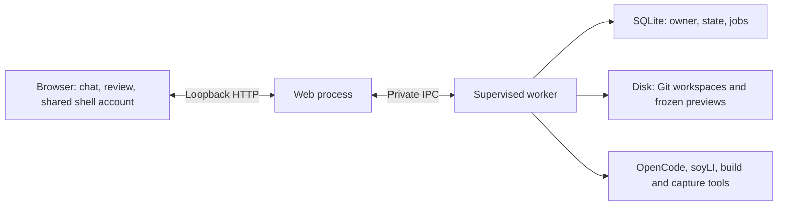

# Quick Vibe: local creation studio

An experimental, prompt-first workspace on `feature/quick-vibe`: describe a napplet,
play its checked build, keep iterating in the same conversation, and review a release for publication. Code and Git
changes are available alongside the preview. This is a local development tool,
not a hosted service or a production inference-provider decision.

## Start

Prerequisites: this checkout's Bun dependencies, Git, a working released soyLI on
PATH, and an inference provider or local model server. The current adapter is tested with **OpenCode V1
1.19.3** (`opencode-ai`, not the separate V2 package).

```sh
bun install --frozen-lockfile
npm install --prefix .local/quick-vibe/tools opencode-ai@1.19.3
bun run studio
```

Open the shared header’s **Account & settings → AI connections** (or the model name
in the composer) to
save a named endpoint, model, API key and step limit. OpenRouter, OpenAI, Anthropic,
Google Gemini and DeepSeek have native provider adapters. Groq, Mistral, xAI,
Together, Fireworks, Ollama, LM Studio, llama.cpp and custom servers use an
OpenAI-compatible adapter. Select a model that supports tools and enough context
for the installed guidance; a model catalogue test does not certify those features.

An existing `DEEPSEEK_KEY` in this checkout's ignored `.env` or shell is imported
**once**, when the connection store is first created. `QUICK_VIBE_MODEL` chooses
that imported connection's model. Later edits are managed in Connections; removing
it does not recreate it on restart. Startup works without a key.

Credentials are stored in `.local/studio/credentials/connections.json` with mode
`0600`, outside napplet Git workspaces. This is OS-user file protection, not encrypted
storage or a production credential vault. List/state responses return only
`hasKey`; the browser never receives a saved key. The selected key is written to
OpenCode's private auth file for the run and cleared on normal completion or the
next startup. Agent subprocess environments omit the checkout's other secrets.
Do not place credentials in a napplet or paste them into chat.

Connections can be edited, tested, selected and removed while the worker is idle.
Testing makes a bounded, non-redirecting model-catalogue request, without generation.
Changing a credential's endpoint requires re-entering the key. Switching connection
or editing its configuration starts a fresh agent session with recent conversation
context, while retaining the repository, previews and full Studio chat history.
No provider fallback or automatic paid retry is performed.

Run the shell as well (`bun dev` for the normal development stack), then open
`http://127.0.0.1:3000/studio`. Studio is a page in the shell, with its shared header,
appearance control and account menu. AI connections and napplet handler defaults live
in that account/settings popover, including when signed out. The execution service still listens on loopback
port 4195; old Studio bookmarks redirect to the matching shell page. Ctrl+C in the
Studio terminal stops its worker/tools/previews, not the shell.

If the shell uses another port, set its exact origin when starting the worker, for
example `QUICK_VIBE_SHELL_ORIGIN=http://127.0.0.1:4196 bun run studio`.

Optional configuration:

| Variable                  | Purpose                                                                                                                                  |
| ------------------------- | ---------------------------------------------------------------------------------------------------------------------------------------- |
| `QUICK_VIBE_PORT`         | Loopback port; `0` chooses a free port.                                                                                                  |
| `QUICK_VIBE_SHELL_ORIGIN` | Exact permitted local shell origin for API access and old-bookmark redirects; default `http://127.0.0.1:3000`. Only HTTP loopback origins are accepted.                |
| `VITE_QUICK_VIBE_PORT`    | Set when starting/building the shell if Studio uses a port other than `4195`. Use an explicit Studio port for shell integration.         |
| `QUICK_VIBE_HOME`         | Private state directory; default `.local/studio`.                                                                                        |
| `QUICK_VIBE_OPENCODE`     | Absolute path to the pinned OpenCode executable.                                                                                         |
| `QUICK_VIBE_SOYLI`        | Absolute path to soyLI; defaults to PATH discovery.                                                                                      |
| `QUICK_VIBE_MODEL`        | OpenCode model identifier; default `deepseek/deepseek-flash`. Used only for the initial DeepSeek import; saved settings take precedence. |

## Navigation and saved creations

The shared shell header offers **Create in browser** and **Use soyLI locally**
as separate actions. **My creations** opens the saved-project dashboard. The shell's
`/create` page also explains both paths and retains its existing CLI setup guide.
Browser links stay on the same site. In a development build on HTTP loopback, Studio
connects to the configured local worker. Production builds show an availability
explanation; they never probe localhost or expose this trusted local runner.

Studio routes are `/studio` for the dashboard, `/studio/create` for a new draft,
and `/studio/<project-id>` for an existing workspace. Direct links, reload and
Back/Forward preserve the selected project. The dashboard offers search, ordering
by recent edits/creation/name, and filters for drafts, published releases, remixes
and work needing attention. Publication status reflects the saved Studio release
attempt; it does not discover projects published independently through the CLI.

**Remix this** offers browser creation alongside the existing soyLI commands.
The browser link preselects the exact release source and a suggested title.
Opening either creation link only opens a form: the user must submit a prompt to
create a repository or start inference. Explicit loopback remix sources use soyLI's
local network mode. Source resolution, attribution and publication still belong
to soyLI. Full public-service remix acceptance remains to be verified.

Existing drafts remain in the same private store; this navigation change requires
no draft migration. The local controller still uses its token-protected loopback
HTTP adapter for connection settings and bounded binary asset uploads. Its CORS
allowlist is the single configured shell origin; other origins, including sandbox
`null` origins, are rejected. A read-only session handshake supplies the per-process
token. No automatic retries of writes occur after ambiguous network failures.

The embedded preview retains the real soyLI host bridge and sandboxed napplet frame,
but removes workshop chrome, padding and frame borders. Open preview still opens the
full workshop separately. The workspace fills the viewport below the header, with
scrolling retained for long chat/source content and no extra visible scroll tracks.
This does not choose a hosted REST API or change GRASP/Nostr publication protocols.
Rename/archive/export remain separate follow-up work. Remix proposals use the
reviewed submission flow described below.

## Shared visual theme

`packages/runtime/src/appearance.css` is the central theme for shell colors, light/dark
variants, font families and header width/gutters. The shell and Studio consume those
same variables; Studio has no separate palette or font stack. The shared palette uses
near-white/slate surfaces and deep teal actions, with soft coral,
mint and lilac accents. Darker text, clearer borders and solid selected controls
retain strong contrast. Shared `--tint-*` colors provide subtle card and toolbar
surfaces in both light and dark mode. Light mode uses forest charcoal for its
header, dark text and code panels, echoing the landing-page film's green backdrop;
dark mode retains its slate palette. Font files are loaded
once by `apps/web/src/styles.css` (add a matching font import there if choosing a new
web font). `apps/studio/style.css` holds workspace layout and component rules.

The header has the same alignment on browsing and Studio pages; only the editor
surface extends to the viewport edges. Intent-handler defaults are settings, not an
inline page footer. Theme changes do not style napplet documents inside their sandbox
or change the creative defaults shipped to developers.

## What the studio does

1. **Prepare.** Fresh drafts use `soyli new --identity later --no-install`, then
   `soyli setup`. The Remix option delegates source resolution and ancestry to
   `soyli remix`; it does not introduce a new collaboration protocol. Only use
   projects you trust to execute locally. Remixes retain soyLI's source selection
   and upstream binding; preparation does not register a public repository.
2. **Edit.** OpenCode works in the actual Git project. The controller supplies the
   installed soyLI and visual guides plus make/UI/test skill bodies, explicitly,
   on each turn. File discovery alone is not considered evidence of skill loading.
   The model can inspect and edit application files and run selected build checks.
   Project dependencies, build configuration, existing tests and installed guidance
   are protected; the controller checks them against the initial source revision.
3. **Verify.** By default, independently run `soyli run verify`, `soyli check`, and
   `soyli run test:conformance`. Capture failures and skipped cases from both output
   streams. A failure gets one agent repair pass, then another independent check.
   An agent's success claim or step-limit exit does not bypass these commands.
4. **Play.** Only passing builds replace the preview. Runtime inputs are copied to
   an immutable snapshot served by the existing soyLI host, including its real
   `allow-scripts` sandbox, hash verification and SDK bridge. Workshop presentation
   is compacted; snapshot mutation endpoints are disabled. The last passing build
   stays playable during edits, failures and cancellation. Passing checks do not
   certify gameplay, accessibility or responsive behavior: play the result and feed
   concrete observations back into chat. Skipped conformance checks remain skipped.
5. **Continue or restore.** Chat, OpenCode session IDs, diagnostics and checkpoints
   persist outside the project Git repository. Browser reloads reconnect to the
   current job. Controller restarts mark interrupted jobs stopped, without retrying
   inference automatically. History can restore a passing checkpoint after saving
   current source to a backup commit; it does not reset or rewrite Git history.

## Experimental browser builds

For an existing standard TypeScript draft, enable **Browser builds** below the
preview (on a phone, first open **Preview & code**). **Build in browser** and
subsequent chat turns then run TypeScript 5.9.3 and esbuild WASM in a browser Web
Worker. The worker receives a bounded source snapshot and the installed SDK files;
it does not execute package scripts or Vite configuration. The resulting HTML
uses the same soyLI sandbox, SDK bridge and immutable preview snapshots.
The tab reuses its compiler and cached SDK/type libraries. After the first build,
only changed files and removals cross to the browser. The cache holds one bounded
snapshot in memory; it is cleared when the compiler is disabled, the page closes,
or a worker fails. A missing cache causes a fresh snapshot on the next requested
build. Neither source nor credentials are added to persistent browser storage.
Restart the local Studio service after updating; older workers do not advertise
browser-build support, so the new UI hides the option until they are updated.

This is an opt-in local experiment, not the default verification path. Its toggle
lasts for the current Studio page session. Keep that tab open while building;
reloading or navigating away interrupts its compiler. Stop and retry explicitly
if necessary. Worker/startup failure, source changes during a build and the
two-minute deadline retain the previous preview without automatically spending
another inference turn. Source diagnostics receive the existing one repair pass.

The first profile supports the unchanged soyLI TypeScript starter configuration
and dependencies, TypeScript/JavaScript/CSS/JSON under `src`,
`config.schema.json`, and assets imported through **Assets** or `soyli assets`.
Use the generated `assetUrl`/`assetBlob` helpers. Embedded assets become data URLs;
registered embedded paths also work in HTML media attributes and CSS `url()`.
External assets retain the sandbox resource bridge and are served from the
immutable local preview, without a Blossom upload. All assets retain soyLI's
hash, MIME, size, source-content and regular-file checks. No arbitrary filesystem
or network resolver is added to the compiler.

Custom configurations/dependencies, dynamic backends, `public/`,
`napplet.config.ts`/`.js`, `srcset` and unregistered HTML media references remain
unsupported. Limits are 2 MiB of project text source, 12 MiB of complete compiler
input (including libraries and base64 embedded assets), 512 input files, and
8 MiB of output. Delta transfers do not bypass these limits. The existing managed
asset limits remain 10 MiB each / 32 MiB total; larger embedded collections may
need external delivery or normal soyLI checks to fit the browser profile.

Only preview type-checking/bundling moves to the browser. Workspace preparation,
the OpenCode process, inference-provider connection, source/Git storage and preview
serving still use the local service. In this mode the agent is instructed to edit
and return; its soyLI build commands are removed from the tool allowlist so it
does not repeat those builds on the host. These permissions are workflow controls,
not an OS sandbox. Browser-preview success is labelled **full checks pending**.
Publication and proposal preparation always run the normal independent soyLI
checks; browser output never replaces their native release build. Initial project
creation and History restore also retain the normal flow.

The compiler worker and WASM add roughly 16 MB of uncompressed assets, requested
only when the compiler is used and retained for subsequent builds in that tab.
Initial project creation, broader package support and real-device performance
remain follow-up work. See the
[experiment results](experiments/STUDIO-BROWSER-BUILD.md) for measurements and
verification boundaries.

## Activity and assets

An expandable **Inside the workshop** panel appears directly beneath the working
indicator. It shows installed guidance loads, normalized tool actions/statuses and
reported step/cost totals. A separate **Reasoning** disclosure is collapsed by
default and shows text the selected provider exposes through OpenCode's reasoning
channel. Models may provide summaries or no reasoning at all. OpenCode emits
completed blocks, so these appear during the run as blocks finish, rather than
token by token. This setting does not enable a model's optional reasoning mode.
Runs made before this feature cannot be reconstructed from Studio history.

The latest run's reasoning survives browser/controller restarts outside the project
Git repository. Each inference run, including a repair pass, starts a fresh view.
Storage is bounded to the latest 16 blocks and 12,000 characters per block, with
visible notices when shortened. Saved provider credentials and recognizable secret
patterns are redacted; raw tool arguments, opaque provider signatures and encrypted
reasoning are never forwarded. Replies and reasoning render a small escaped Markdown
subset. HTML is never rendered from model output.

Each connection has a configurable **10–100 steps per run** (default/imported value:
100). Existing saved choices are retained; change them in Connections. Reaching it is called out separately from Studio's build/sandbox/conformance
results. A passing preview can still have unfinished requested features. Continuing
requires a new user message. Publication screenshots and recordings are captured
and reviewed in Publish, not implied by passing a build.

The **Assets** tab imports in-app assets using the same importer as soyLI. Choose a
file, drag/drop it into Assets or chat, or paste an image; review its stable name,
license/permission, provenance and embedded/external delivery before adding it.
The composer paperclip opens Assets. No upload starts just by selecting a file.
Progress and cancellation are shown; an interrupted response may have reached the
server, so inspect the inventory before retrying.

Imports are serialized with agent/build/publication work, require an initialized
idle project, invalidate publication review, and keep the last passing preview.
There are no arbitrary filesystem paths or base64 chat payloads: the local HTTP
adapter bounds raw bytes before sending them over private worker IPC. Reusing the
shared importer retains MIME/content/credential checks, content-hash filenames,
`napplet.assets.json`, `soy-assets.js`, and current **10 MiB/file, 32 assets and
32 MiB/project** budgets. Active HTML/SVG/scripts are refused. Images, audio and
video can be previewed; other supported files show their metadata.

**Ask maker to use it** prepares an editable prompt containing the stable asset ID;
the next agent turn can use `assetUrl`/`assetBlob` and preserve attribution. Adding
an asset does not run inference or upload it to Blossom. It becomes part of public
source when the user publishes; externally delivered assets follow the existing
release review and publication flow. Private AI reference attachments, release-media
replacement, inventory removal, remote imports, archive extraction and transcoding
are not implemented in this local slice. Keep private references out of Assets.

## Publish from the studio

The **Publish** button opens one prepare → review → publish flow. A direct chat
request such as “Let’s publish this” opens the same flow without asking the model
to run a publishing command. More elaborate chat requests can help prepare the
project, but cannot authorize public writes through the agent.

1. **Use your shell account.** The same account menu supports NIP-07 extensions,
   NIP-46 remote signers and local-key accounts. Choose **Use shell account** in the
   release review. If no account is selected, the review closes and opens the shared
   account menu; reopen Publish after connecting. No popup is needed. Keys and
   remote-session credentials stay with the shell or signer. Publication sessions
   are pinned to the selected public key, validate allowed event kinds and exact
   signed contents, and invalidate on account change/sign-out. A saved release
   review still checks its original author before resuming.
2. **Prepare.** Edit the title, description and tags. A fresh landscape screenshot
   is required; a short clip is selected by default, and portrait promotional
   captures are optional. The controller runs the existing checks and capture
   helpers, commits a local candidate, validates source history, and produces a
   soyLI dry-run plan. This phase makes no public uploads or signed events.
   Captures follow the project's `preview.recording` timing/input recipe. Use
   **Improve listing & capture plan in chat** to prepare a prompt, then send it
   when ready. Inspect the resulting media; a passing build does not guarantee a
   useful gameplay clip.
3. **Review.** See actual captures, editable metadata, author, source revision,
   license and publication destinations. Portrait files are downloadable and are
   included in the public source; they do not introduce extra manifest fields.
   Source/history and publication inputs are bound to this review. Editing the
   project or changing the selected repository requires another preparation.
4. **Publish this version.** Confirm the review, then approve signatures with your
   selected signer. The existing soyLI publisher handles Git/GRASP, Blossom and NIP-5D,
   preserving stable listing identity, remix attribution and retry journals.
   Keep the browser tab open while signing. The controller checks returned event
   signatures, author and every requested event field before accepting them.
5. **Recover.** Preparation failures can be sent back to chat. A service or signer
   failure offers **Resume the saved release** using its frozen bytes, even if
   the editable draft has since changed. Reconnect the same author after a page
   reload/controller restart and confirm the saved review. Pending website indexing
   has a separate availability check; it does not rebuild, re-sign or ask the AI.
   Stop cancels outstanding signing/process work; already accepted public steps
   remain recorded and cannot be recalled by cancelling.

The ordinary CLI workflow remains available in the same workspace. CLI account
selection and the shell account are separate: connecting your shell account
here does not change the global soyLI account. Existing pending CLI journals may
require finishing that release in the CLI before preparing another one here.

The Files tab is read-only. Use chat for edits or open the saved workspace in your
usual editor while the agent is idle. Changes compares against the initial source.
The preview does not live-reload arbitrary external edits: **Run checks** promotes
them after verification. Those checks also work without another inference request.

## Propose changes from a remix

A remixed draft with a passing preview exposes **Propose changes** beside Publish.
Connect the same shell account, describe the contribution and prepare it. Studio
checks the build, checkpoints the source, validates its history, reads the signed
upstream repository announcement, and shows the upstream, merge base, exact commit,
build hash and contribution text. Preparation does not sign or upload anything.

After explicit confirmation, the existing soyLI collaboration service publishes
ordinary forkless GRASP/NIP-34 changes (kind 1618, or 1619 for an update) and a playable
snapshot (kind 5129). It does not create a new napplet listing or repository wrapper.
The signer and reviewed source, description and upstream are checked again before
submission. Edited source must be prepared again. Retry reuses the signed journal;
if signing stopped before a journal existed, it retries the same unchanged review.
The proposal is available to maintainers through their existing Nostr Git workflow.

## Local limits and custody

- One active turn across up to 20 drafts. A model run has its connection’s 10–100-step budget and a
  10-minute process timeout; a complete turn including its single repair attempt
  has a 20-minute timeout. Estimated dollar usage is informational, not a billing
  guarantee or an enforced dollar cap. Nothing retries or changes providers silently.
- No payments or backend deployment UI. Dynamic backend modules
  are not supervised by this version and publication preparation rejects them.
  Continue those projects using the regular soyLI workflow.
- API requests require the page's token and same origin (JSON actions or bounded binary uploads). The server listens
  on `127.0.0.1`, checks its Host/Origin, limits input sizes and restricts file reads
  to its own project sources. Do not expose this process through a public tunnel.
- Agent tool permissions are **not an OS sandbox**. Build scripts and agent tools
  execute with your OS permissions. The credential file is outside the workspace,
  but a hostile process running as your user could still access it. Hosted creation
  needs separate execution isolation and credential custody before deployment.
- Stop/normal shutdown terminates owned process groups, including build children.
  The web process supervises a separate worker and its reported tool groups. If the
  worker dies, the supervisor stops those groups; losing the supervisor's IPC
  connection makes the worker stop its active job. Restart manually and inspect
  the saved draft before continuing. This is process supervision, not a container:
  simultaneous failures or deliberately detached processes still require OS-level
  isolation in a hosted version.
- A SQLite writer lock prevents two workers using the same store and releases when
  its process exits. The store belongs to one configured owner. Locally this is the
  OS user ID; it is not browser authentication. Changing the publishing signer does
  not transfer draft ownership. The reserved Nostr owner format is for a future
  authenticated dispatcher, not a way to claim a workspace through the API.
- Local checkpoints and frozen artifacts are retained, with no automatic deletion
  or export UI yet. Keep enough disk space and back up the private state directory.

Data lives under `.local/studio/` (Git-ignored):

```text
studio.sqlite                      conversation, sessions, checkpoints, reviews, job history, owner
studio.sqlite-wal / -shm           SQLite sidecars while running
writer.sqlite                     exclusive worker lock, released by the OS on exit
runtime.json                      informational web/worker PIDs and loopback URL
state.legacy-v1.json               exact backup when importing an earlier JSON store
agent/                             OpenCode auth/config/session data
projects/<id>/workspace/            ordinary soyLI Git project
projects/<id>/previews/<commit>/    frozen runtime inputs for passing builds
projects/<id>/publications/<id>/    captured media and immutable review copies
projects/<id>/workspace/.napplet-space/  ignored binding and soyLI publication journals
```

On the first start after upgrading from JSON storage, stop the older studio first.
The worker validates `state.json`, preserves it, writes a private exact backup as
`state.legacy-v1.json`, and imports it into SQLite once. Later starts use SQLite;
editing the old JSON does not change current drafts. Source repositories, snapshots
and publication journals are left in place. Invalid legacy state fails startup
without replacing it. If an old `studio.lock` remains after a crash, verify its
recorded process is gone before removing that legacy file. Never remove a live
worker's database or lock files.

State and job transitions are transactional. Each job is recorded before tools run;
an interrupted job becomes stopped on restart and never resumes spending or signing
automatically. The last 100 job records are exposed in local API state. SQLite does
not make source/tool filesystem changes transactional: inspect the working tree after
an interruption, then continue or run checks. Back up the entire private directory
while the studio is stopped, including its Git repositories and agent sessions.

To continue in a terminal, change into the workspace and use ordinary soyLI commands.
The studio's local Git commits use `Quick Vibe (local)` as the author; they do not
claim the creator's identity. Publication events are signed separately by the
selected browser account.

## Where the repository lives in production

Today the repository is on the computer running `bun run studio`, under the path
above. The browser is a UI, not the source store. Before publication it is a private
local Git repository with no newly registered GRASP repository. Publication creates
or updates public source using the ordinary soyLI rules.

For a hosted version, the corresponding private workspace would live on durable
server-side storage, associated with an authenticated owner. An isolated worker
would check out that workspace, run the agent/build/capture tools, and save its
checkpoint before being discarded. The browser would continue receiving chat,
diffs and an isolated preview, with signing under the creator's control.

Private source checkpoints could use the optional
[GRASP-08 private repository extension](https://ngit.dev/protocol/grasp/specification/08).
Its access whitelist applies to a whole service, rather than individual repositories.
Independent creators therefore need separate access domains; one shared whitelist
would expose their drafts to each other. Authorized readers and the server can read
the content: this is access control, not end-to-end encryption. Private repository
metadata must stay on its designated private relays. No private GRASP storage is
configured by this local slice. The current public GRASP service remains the
publication destination.

Git transport can store source/history but does not replace agent/build jobs or
their progress channel. The hosted preparation now includes an encrypted CVM control
adapter that derives workspace ownership from the signed caller, plus a bounded,
network-disabled container executor. The isolated runner now supplies agent, project
command, capture and publication-check adapters as one set, with a per-job inference
broker. The browser still uses the local runner; hosted browser transport is not enabled. See
[Studio hosting preparation](STUDIO-HOSTING.md) for the exact boundaries.
The current VPS also needs a compatible virtual CPU: it does not expose the SSE4.2
feature required by the prepared toolchain. The image and job preflight reject
that configuration before starting Bun; the local Studio remains available.

For storage, retain portable projects and their installed guidance. Prefer shared
immutable toolchains/package caches and isolated copy-on-write workspaces; rebuild
inactive dependencies and outputs from lockfiles. Do not share writable agent files
between creators. Preview/media retention and content-hash reuse need explicit
policies before hosting. No workspace cleanup or cross-project deduplication is
implemented by this slice.

The local foundation now separates the web process from the job engine:



The worker's small interface exposes draft actions, files, previews and publication;
the browser cannot submit shell commands or choose a filesystem owner. A crashed
worker fails outstanding requests instead of replaying potentially completed writes.
The existing review and signing controls still govern publication.

This is not an enabled hosted deployment mode. The production path still needs
complete Linux acceptance, production credential custody/spending policy, authenticated
browser control and private previews on isolated origins. The local web process must
remain on loopback. Broader storage/recovery work is deferred; existing disk-backed
Git and SQLite state remain in use.

## Verification

`bun run test:studio` exercises real child processes for build failure/repair,
session recovery, frozen preview retention, restore backups, cancellation of process
descendants, protected checks, HTTP origin/token enforcement, duplicate submissions,
read-only preview endpoints and actionable/redacted errors. Publication tests use
real Git and Nostr signatures with in-memory relay/Git-host/blob service adapters:
unsigned preparation, changed-input rejection, account/tamper/replay rejection,
stable listing updates and frozen retry after an upload failure. HTTP checks reject
unconfirmed publication, missing reviews and unauthenticated signer/media access.
Worker integration tests exercise HTTP through real Bun IPC, concurrent request
deduplication, build repair, preview artifact delivery, useful redacted errors,
signing-session expiry, hard worker termination, supervisor death and process-group
cleanup. Store tests cover exact legacy backup/import, ownership, exclusive writers,
atomic job/state transitions and invalid input. The suite needs loopback binding.

`bun run test:studio:services` separately exercises reviewed proposals against real
GRASP, relay and Blossom services. It builds the native servers before starting
the test timeout. This requires the Rust version pinned in
`services/grasp/upstream.json`, Go and a C compiler; Linux also needs `pkg-config`
and OpenSSL development headers. The **Studio services** CI workflow provisions
these prerequisites on a fresh runner. Regular `bun run check` and `test:studio`
do not compile native servers or depend on a developer's cached GRASP binary.

`bun test apps/cli/src/creator-kit.test.ts` checks the assembled guidance, including
removal of stale Paja/standalone-scaffold instructions from the entry skill.

The initial harness evidence is in [QUICK-VIBE-EXPERIMENT.md](QUICK-VIBE-EXPERIMENT.md).
Local acceptance on 2026-10-17 used the real DeepSeek adapter to create Orbit Pop
Studio and add a session-best score in the same conversation. Browser reload and
controller restart retained the project; Stop during checks retained the old preview,
and Run checks recovered. Independent browser tests passed pointer/Space/reset/best
score, 200×160, 320×560 and 900×600 frames, plus Chromium touch emulation at 390×844
and 844×390, without app page errors. The app remained in an `allow-scripts` iframe.
The model reported approximately $0.064 total for these two turns; this is an
estimate, not a verified provider invoice. The full repository check passed 739
tests; subsequent preview-lifecycle refinements passed typecheck and the 8-test
studio suite. No deployment or release was performed.

Public hosted integration, physical-phone/Safari coverage, provider billing, public
remix/proposal end-to-end verification and workspace export remain open.
The publication slice passed the full repository check (744 tests) and a final
typecheck. The local publication rehearsal uses a separate copy of Orbit Pop, captures actual
landscape and portrait PNG/WebM media, and verifies review, phone layout, failure
recovery and chat handoff. Its service adapter disables public writes; these tests
do not claim a real extension approval or a successful public release.

The supervised-worker slice passed `bun run check`: **751 tests, 0 failures**, plus
TypeScript checking. The running local studio was upgraded on 2026-10-17: both
existing drafts, seven checkpoints, full saved conversations, Git HEADs and working
file status were preserved. The legacy backup is byte-for-byte identical and the
SQLite file is owner-readable/writable only. Browser verification reopened the
existing preview, confirmed Space input and the `allow-scripts` iframe, and opened
the unchanged Publish form with preparation disabled until a signer connects.
No inference or public publication was performed for this migration check.

The local navigation/dashboard slice passed all 23 Studio tests (179 assertions),
TypeScript checking and a production web build. Browser checks covered both header
actions, dashboard search, direct workspace reload, the saved playable preview,
and the dashboard/create flow at 390×844 without horizontal overflow. Workspace
height accounts for the two-row mobile header. Both existing drafts, seven
checkpoints, full conversations, Git HEADs and working status matched the pre-change
backup. No inference, new real draft or public publication was triggered by these
navigation checks. Private GRASP, hosted job transport and storage deduplication
remain proposals, not verified features.

The adapter follows OpenCode's documented [CLI/session interface](https://opencode.ai/docs/cli/)
and [tool permissions](https://opencode.ai/docs/permissions/). Its narrow adapter
boundary allows replacing the harness without replacing soyLI projects.

Shared-account and proposal verification (2026-10-17): `bun run check` passed
767 tests / 6,051 assertions, and the website production build passed. After final
retry/UI amendments, the 36 Studio tests passed (310 assertions), with TypeScript
checking clean. Browser
checks exercised the shell’s real account picker with a disposable extension,
account switching/revocation, reconnection and the 390px publication layout.
Local NIP-46 tests sign all website publication/contribution kinds. Proposal tests
use real local relay, GRASP and Blossom services and verify unsigned preparation,
review guards, exact source and stable retry without a new listing. The user reported
a successful public Obsidian Breaker release; its saved Studio publisher journal
also records publication. No additional public release was made during these checks.

The two creation header actions share the shell's animated glint, icon motion and
keyboard-focus treatment. Browser creation uses lime and local soyLI uses lilac.
Both remain visible on phones and respect reduced motion. This UI update preserves
the existing local drafts, selected connection and publication journals.
